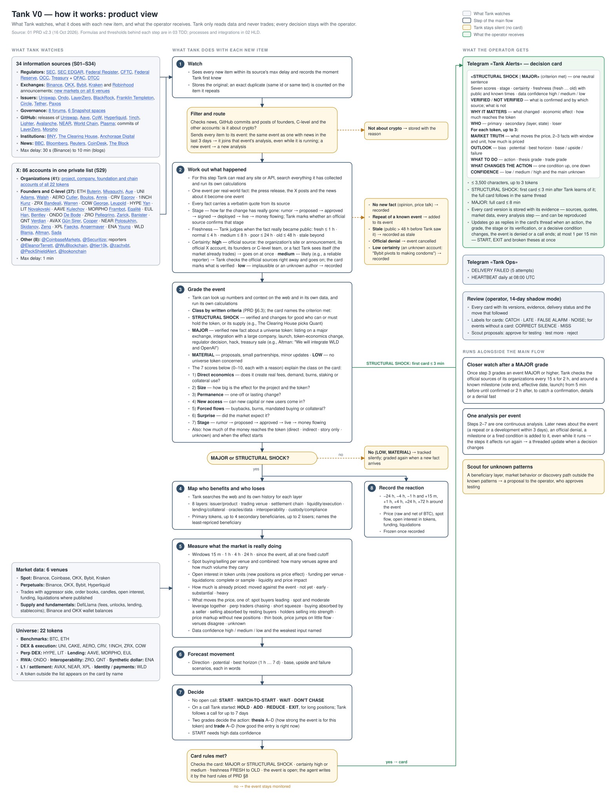

# Tank V0 — Major Event Hunter
## Product Requirements Document (PRD)

| | |
|---|---|
| Document | 01 of 3 — PRD: what Tank does, for whom, from which information, with which results, how success is measured |
| Companions | 02 — System Architecture (components, integrations, data flows, deployment) · 03 — Technical Design (data structures, algorithms, thresholds, field semantics, tests) |
| Version | 2.3 — fixed MVP baseline |
| Date | 2026-10-16 |
| Amendment | 2026-10-26 — preliminary cards and timed event reviews (MR #42); open implementation gaps: 03 §11.6 |
| Scope | Tank V0 only (spec v0.4-1 incl. Rev 0.2, Addendum 001, Addendum 002-A "promoted changes", Addendum 002-B "capital-weighted breadth & price-flow divergence") |
| Verification | Sources, accounts, tokens and venue listings named here were checked live on 16 Oct 2026. |

**How the three documents divide the content.** A statement belongs in this PRD when it would stay true if the implementation changed (another language, model, database or API): what Tank watches, what it produces, the rules it follows, when it speaks or stays silent, the quality and cost it must meet, and how it is accepted. Components and integrations (endpoints, processes, storage, deployment) are in 02. Formulas, thresholds, field semantics, schemas, model settings and test fixtures are in 03. Numbers that the operator experiences directly (delays, alert limits, budgets, how much is analyzed) stay here; numbers that tune an algorithm are in 03 and referenced by name.

"MUST" marks a requirement that acceptance tests check.

---

## 1. What Tank V0 is

Tank V0 is an always-on service that:

1. watches **34 named information sources** — US regulators, exchanges and brokers, protocols and issuers, governance forums, GitHub, 86 X accounts, BBC, Bloomberg, Reuters, CoinDesk, The Block (§4.2–4.3);
2. watches **market data on 6 venues** — Binance, Coinbase, OKX, Bybit and Kraken spot markets; Binance, OKX, Bybit and Hyperliquid perpetuals (§4.4);
3. turns new information into **events** about a **22-token universe** and its ecosystem (§4.1), each handled as **one continuous analysis** that later news about the event joins (D8);
4. grades each event, maps who benefits and who loses, measures what the market is really doing underneath the price, and forecasts movement as scenarios;
5. sends **ordinary decision cards to Telegram** for major events and their material changes; a selected MATERIAL lead may receive a clearly marked preliminary card under FR-A-08.

Tank V0 never places orders. All decisions stay with the operator.



*Product view: what Tank watches, how it filters and routes each new item, the steps of the one analysis it runs per event, where it stays silent, and what the operator receives.*

### 1.1 Terms

| Term | Meaning | Example |
|---|---|---|
| Item | One new piece of content from one source: a press release, an exchange announcement, an X post, a governance proposal, a new market in a venue's instrument list. | Bybit announcement "New listing: Listing of DNAUSDT on Bybit Perpetual on Oct 16, 2026, 11:45AM UTC". |
| Event | The real-world change behind one or more items. Every item about the same fact belongs to one event, handled as one continuous analysis (D8), so Tank reacts once and keeps the time it first knew. | "The Clearing House partners with Quant on on-chain money" (24 Sep 2026): the TCH press release, the posts on X and the news articles about it are one event. |
| State | How far the event has really progressed: rumor → proposed → approved → signed → deployed → live → money flowing. The card shows the stage and whether it is verified. | The Aave proposal to onboard USAT, voting until 18 Oct 2026 → proposed. |
| Certainty | How credible the fact is. HIGH: an official source — the organization's site or announcements, a regulator's publication or filing, its official X account, or its founders and C-level team speaking about their own organization — or a fact Tank observes itself (the new market already trades). MEDIUM: likely true but not verified — a reliable reporter, or a founder speaking about another organization. LOW: implausible, or an unknown author; never an ordinary card. A sourced MATERIAL lead may qualify for a preliminary card under FR-A-08. | Sam Altman posts "we will integrate WLD and OpenAI" → HIGH. An unknown account posts "Bybit pivots to making condoms" → LOW. |
| Freshness | How long before Tank learned it the event really became public. Tank judges this from the content and its sources, not from the time of the post: FRESH ≤ 1 h, NORMAL ≤ 4 h, MEDIUM ≤ 8 h, POOR ≤ 24 h, OLD ≤ 48 h, STALE beyond. | A founder posts now: "yesterday we shipped X and told all the press" → public yesterday → not fresh, even though the post is new. |
| Grade | LOW, MATERIAL, MAJOR or STRUCTURAL SHOCK, set by the class criteria of §6.3. MAJOR and STRUCTURAL SHOCK qualify for ordinary cards; MATERIAL may qualify for the preliminary exception in FR-A-08. LOW event class never produces a card. | — |
| Thesis and Trade grades | A–D per token on the card. Thesis: how strong the event is for this token — its class, how much value reaches the token, how exposed the token is, how far the stage has progressed. Trade: how good an entry is right now — what is moving the price, how much is already priced, liquidity, data confidence. | WLD, 16 Oct 2026: a perp-led move gives Trade C → DON'T CHASE. |
| Card | The Telegram message about one event (§7.1); later changes arrive as replies in its thread. | — |
| Call | A START that Tank gave on a token. Tank follows it until EXIT, at most 7 days, and says in the card's thread when it stops. | — |

---

## 2. Problems Tank V0 solves

| # | Problem | Concrete example | What Tank does |
|---|---|---|---|
| P1 | Late discovery | Binance listing notices, SEC rule-filing notices in the Federal Register, Aave proposals on Snapshot and Bybit perp listings appear in different places at different times. | Watches every source within a stated delay (§4.2) and records when Tank first knew. |
| P2 | Old news recycled as new | A crypto outlet re-reports a three-day-old approval as if it were news. | Works out when the fact really became public; a fact public more than 48 h before Tank learned it is stale and gets no card. |
| P3 | Proposal confused with implementation | CFTC's "Regulation Crypto Asset Transactions and Regulation Crypto Asset Markets" (Federal Register, 13 Oct 2026) is a *proposed* rule, not a rule in force. | Reports the stage and whether it is verified: proposed ≠ approved ≠ live. |
| P4 | Headline-token bias | Sep 2026 call log: "Ondo/BlackRock Intelligent Portfolios settling through CoW" — the tradable beneficiary was COW, not the headline names. | Walks the whole economic stack and names secondary beneficiaries and losers. |
| P5 | Activity confused with token value | "World Money live in 150+ countries" does not, by itself, pay WLD holders. | Shows how much of the activity actually reaches the token: direct, indirect, narrative-only or unknown. |
| P6 | Market response misread | QNT on 26 Sep 2026, 19:00–23:00 UTC: open interest in dollars rose ~20% while the number of open positions barely moved (+0.4%) — the "growth" was price. One venue's headline open-interest figure counts both sides of every position. | Measures positions in token units, separates price effects, compares venues by the volume they carry. |
| P7 | No usable forward view | Either no forecast or "67% chance of +14%". | Direction, potential, horizon and base/upside/failure scenarios; no probabilities. |
| P8 | Noise or silence at the wrong time | Dozens of pings per day, or nothing when it matters. | Ordinary cards for major events and material changes; selected preliminary leads under FR-A-08; one daily heartbeat to the ops chat. |
| P9 | Silent data gaps and wrong identities | Some venues publish only a sample of liquidations; a ticker can belong to two different projects (LIT). | Every gap is shown as a gap, sampled data is labeled, tokens are identified by project, never by ticker. |

---

## 3. Users and channels

| Role | Channel |
|---|---|
| Operator (one person) | Telegram chat **"Tank Alerts"** — decision cards and their threaded updates. |
| Operator as system owner | Telegram chat **"Tank Ops"** — the processing card of every new material, source entries Tank could not read, failed card deliveries and the daily heartbeat (§7.2). |
| Reviewer (shadow mode, same person) | Review commands on the Tank machine (§7.4). |

---

## 4. What Tank watches

### 4.1 Token universe (22 tokens)

The permanent 19-token watchlist (Master v1.9 §3.1), WLD, and BTC and ETH as benchmarks. Each ticker means exactly the project below; the contract-level identities are fixed in 03 §2.11.

| Basket | Tokens (project) |
|---|---|
| Benchmarks | BTC (Bitcoin), ETH (Ethereum) |
| DEX & execution | UNI (Uniswap), CAKE (PancakeSwap), AERO (Aerodrome), CRV (Curve), 1INCH (1inch), ZRX (0x), COW (CoW Protocol) |
| Perp DEX | HYPE (Hyperliquid), LIT (Lighter) |
| Lending & credit | AAVE (Aave), MORPHO (Morpho), EUL (Euler) |
| RWA & tokenization | ONDO (Ondo) |
| Interoperability | ZRO (LayerZero), QNT (Quant) |
| L1 / settlement | AVAX (Avalanche), NEAR (NEAR), XPL (Plasma) |
| Synthetic dollar | ENA (Ethena) |
| Identity / payments | WLD (World) |

Rules:
- LIT is Lighter, not Litentry; Euler's token is EUL. A token is always identified by its project, never by ticker alone.
- Sector comparisons use the token's own basket when it has at least two other tradable members (DEX & execution, Lending & credit, L1 / settlement); other DeFi baskets are compared against all DeFi tokens of the universe together; WLD has no sector comparison.
- A token outside the universe is never analyzed. When an event names one as a beneficiary or loser, the card names it without a market block.

### 4.2 Information sources (34)

"Max delay" is the longest time between a new item appearing at the source and Tank seeing it. Once an event is graded MAJOR or higher, the official sources of its organizations are checked every 15 s for 2 h (FR-D-02).

**Regulators and market structure**

| ID | Source | What Tank reads | Max delay |
|---|---|---|---|
| S01 | SEC | Press releases; speeches and statements (incl. Crypto Task Force) | 1 min / 2 min |
| S02 | SEC EDGAR | New S-1 registrations — crypto trust/ETF filings | 2 min |
| S03 | Federal Register | New documents of SEC, CFTC, Federal Reserve, OCC, Treasury, FinCEN, OFAC, FDIC about crypto (rules, proposed rules, exchange rule filings) | 5 min |
| S04 | CFTC | Press releases; enforcement actions | 2 min / 5 min |
| S05 | Federal Reserve | All press releases | 2 min |
| S06 | OCC | News releases | 5 min |
| S07 | US Treasury + OFAC | Treasury press releases; OFAC sanctions actions (incl. crypto addresses) | 5 min |
| S08 | DTCC | Press releases | 5 min |

**Exchanges and brokers**

| ID | Source | What Tank reads | Max delay |
|---|---|---|---|
| S09 | Binance | Announcements: new listings, delistings, latest news — full text | 30 s |
| S10 | OKX | Announcements: new listings, delistings, trading updates, events | 1 min |
| S11 | Bybit | Announcements: new listings, delistings, latest news | 1 min |
| S12 | Kraken | Blog (listings, product launches) | 2 min |
| S13 | Robinhood | Newsroom | 5 min |
| S14 | Venue instrument lists | Any new market or status change on Binance (spot, futures), Coinbase, Kraken, OKX (spot, swaps), Bybit (spot, linear), Hyperliquid | 1 min (Kraken 2 min) |

**Protocols and issuers**

| ID | Source | What Tank reads | Max delay |
|---|---|---|---|
| S15 | Uniswap | Blog | 10 min |
| S16 | Ondo Finance | Blog | 10 min |
| S17 | LayerZero | Blog | 10 min |
| S18 | BlackRock | Press releases | 10 min |
| S19 | Franklin Templeton | Press releases | 10 min |
| S20 | Circle | Pressroom | 10 min |
| S21 | Tether | News | 5 min |
| S22 | Paxos | Newsroom | 10 min |

**Governance**

| ID | Source | What Tank reads | Max delay |
|---|---|---|---|
| S23 | Governance forums | Uniswap, Aave, Ethena, CoW DAO, Morpho, Euler, 1inch, NEAR — new topics | 5–10 min |
| S24 | Snapshot | Uniswap, Aave, PancakeSwap, CoW DAO, Morpho, 1inch spaces — new proposals, vote status, results | 2 min |

**Technical artifacts**

| ID | Source | What Tank reads | Max delay |
|---|---|---|---|
| S25 | GitHub | Releases of Uniswap v4-core, Aave v3-origin, CoW Protocol services, Hyperliquid Python SDK, 1inch SwapVM, Lighter Python SDK, AvalancheGo, nearcore, World Chain, Plasma node; commits of LayerZero v2 and Morpho Blue. PancakeSwap, Aerodrome, Curve, 0x, Euler, Ondo, Ethena and Quant publish no release feed with 2026 activity; their news arrives through S15–S24 and S29 | 10 min |

**Institutional and custody**

| ID | Source | What Tank reads | Max delay |
|---|---|---|---|
| S26 | BNY | Press releases | 10 min |
| S27 | The Clearing House | Press releases | 10 min |
| S28 | Anchorage Digital | Press-room articles | 10 min |

**Social**

| ID | Source | What Tank reads | Max delay |
|---|---|---|---|
| S29 | X | Own posts of the 86 accounts in §4.3, with the posts they quote, reply to or link, read from their public profiles through an Apify actor (D3); reposts and replies to other accounts are not read | 2 min |

**News**

| ID | Source | What Tank reads | Max delay |
|---|---|---|---|
| S30 | BBC News | Business; Technology | 2 min / 5 min |
| S31 | Bloomberg | Markets headlines | 2 min |
| S32 | Reuters | Crypto coverage published in the last day (via Google News search limited to `when:1d`, as Reuters has no public feed; without the limit Google ranks years-old articles by relevance) | 5 min |
| S33 | CoinDesk | All articles | 2 min |
| S34 | The Block | All articles | 2 min |

### 4.3 X accounts (86)

On the list: every official account of a universe project's organizations (project, company, foundation, chain or main product), its founders, and its C-level (CEO, CTO, COO, CPO, President, foundation executive director), plus accounts that bring facts the other sources do not carry. Not on the list: people who left the project, investors and other staff, dormant accounts, and accounts whose owner no official source confirms. Posts of these organizations, founders and C-level about their own project count as an official source (FR-E-05).

| Token | Organization accounts (41) | Founders and C-level (37) |
|---|---|---|
| BTC | @bitcoincoreorg | — (no founder account) |
| ETH | @ethereum, @ethereumfndn | @VitalikButerin (Vitalik Buterin, co-founder, EF board), @AyaMiyagotchi (Aya Miyaguchi, EF President), @aerugoettinea (Bastian Aue, EF interim co-executive director) |
| UNI | @Uniswap, @UniswapFND, @unichain | @haydenzadams (Hayden Adams, founder, CEO Uniswap Labs), @devinawalsh (Devin Walsh, executive director, Uniswap Foundation) |
| CAKE | @PancakeSwap | — (team is anonymous) |
| AERO | @aeroxyz, @dromoslabs, @VelodromeFi | @wagmiAlexander (Alexander Cutler, co-founder, CEO Dromos Labs), @jack_anorak (Chris Boulos, President, Dromos Labs), @dannis19024 (David Annis, COO, Dromos Labs) |
| CRV | @CurveFinance | @newmichwill (Michael Egorov, founder) |
| 1INCH | @1inch | @deacix (Sergej Kunz, co-founder, CEO) |
| ZRX | @0xProject, @zeroexprotocol, @matchaxyz | @abandeali1 (Amir Bandeali, co-founder, CEO), @willwarren (Will Warren, co-founder, board) |
| COW | @CoWSwap | @AnnaMSGeorge (Anna George, co-founder), @fleupold_ (Felix Leupold, technical lead) |
| HYPE | @HyperliquidX, @HyperFND | @chameleon_jeff (Jeff Yan, co-founder) |
| LIT | @Lighter_xyz | @vnovakovski (Vladimir Novakovski, founder, CEO) |
| AAVE | @aave | @StaniKulechov (Stani Kulechov, founder, CEO) |
| MORPHO | @Morpho | @PaulFrambot (Paul Frambot, co-founder, CEO), @MerlinEgalite (Merlin Egalité, co-founder) |
| EUL | @eulerfinance | @0xJHan (Jonathan Han, CEO), @euler_mab (Michael Bentley, co-founder) |
| ONDO | @Ondo, @OndoFoundation, @OndoPerps | @iandebode (Ian De Bode, acting CEO and President) |
| ZRO | @LayerZero_Core, @LayerZero_Labs, @LayerZero_Fndn, @StargateFinance | @PrimordialAA (Bryan Pellegrino, co-founder, CEO), @ryanzarick (Ryan Zarick, co-founder, CTO), @caleb_banister (Caleb Banister, co-founder) |
| QNT | @quantnetwork | @gverdian (Gilbert Verdian, founder, CEO) |
| AVAX | @avax, @AvaLabs, @AvalancheFDN | @el33th4xor (Emin Gün Sirer, founder, CEO Ava Labs), @CharleyCooper01 (Charley Cooper, President, Ava Labs) |
| NEAR | @NEARProtocol, @near_ai | @ilblackdragon (Illia Polosukhin, co-founder), @AlexSkidanov (Alexander Skidanov, co-founder), @georgexzeng (George Zeng, CPO) |
| XPL | @Plasma | @pauliepunt (Paul Faecks, founder, CEO), @C_Angermayer (Christian Angermayer, co-founder) |
| ENA | @ethena | @gdog97_ (Guy Young, founder, CEO) |
| WLD | @worldnetwork, @tfh_technology, @worldcoinfnd, @world_chain_ | @alexblania (Alex Blania, co-founder, CEO Tools for Humanity), @sama (Sam Altman, co-founder, chairman Tools for Humanity), @tiagosada (Tiago Sada, CPO, Tools for Humanity) |

| Other accounts (8) | Accounts |
|---|---|
| Coinbase listings | @CoinbaseMarkets |
| Tokenized-asset issuer | @Securitize |
| Reporters and alert accounts | @EleanorTerrett, @WuBlockchain, @tier10k, @zachxbt, @PeckShieldAlert, @lookonchain |

### 4.4 Market data

| Venue | Spot | Perpetuals |
|---|---|---|
| Binance | ✓ | ✓ |
| Coinbase | ✓ | — |
| OKX | ✓ | ✓ |
| Bybit | ✓ | ✓ |
| Kraken | ✓ | — |
| Hyperliquid | — | ✓ |

- From each venue Tank reads trades with their aggressor side, order books, candles, open interest, funding, mark and index prices, and liquidations where the venue publishes them.
- Every universe token trades on at least three of these spot markets and two of these perpetual markets (matrix in 02 §4.10).
- History before an event comes from the venues and from Binance's public data archive.
- Fundamentals and supply come from public data: protocol fees and revenue, unlock schedules, lending markets, stablecoin supply by chain (DefiLlama), and exchange wallet balances where exchanges' wallet lists are public (Binance, OKX).

---

## 5. What Tank does — pipeline

| Stage | Capability | Result |
|---|---|---|
| 1 | Watch sources and market data | New items and market data, each with time and origin |
| — | Filter and route | News, GitHub commits and non-organization posts that are not about crypto are kept but not analyzed (FR-D-06). An item that repeats or develops an event with news in the last 3 days joins that event's analysis, even while it is running (FR-E-02). A later status change of a venue's market for the same asset joins the analysis of the earlier change. Any other item starts a new analysis |
| 2 | Work out what happened | One event per asserted development: facts and unverified claims with quotes, certainty, state, freshness and first-known time; an item with no new fact (opinion, price talk) is recorded and goes no further |
| 3 | Grade the event | LOW / MATERIAL / MAJOR / STRUCTURAL SHOCK, with value-capture and timing. LOW stops. MATERIAL normally stops; a selected sourced lead may take the preliminary-publication and timed-review branch (FR-A-08–09) without stages 4–6 |
| 4 | Map beneficiaries | Primary, secondary, competitor and loser tokens; least-repriced beneficiary |
| 5 | Measure the market response | What is moving the price, with the decisive facts and data confidence |
| 6 | Forecast movement | Direction, potential, horizon, scenarios, what would change the view |
| 7 | Decide and notify | Ordinary Telegram card with an action, preliminary card without market/action blocks, or silence |
| 8 | Record the reaction | Market record from 24 h before to 72 h after each major event |

Stages 2–7 are one continuous analysis per event (D8). The first item starts it; later news about the event, fired conditions (including timed review questions), milestones and expiring calls are added to the same analysis. Published versions stay in one Telegram thread. After a preliminary card, the first ordinary card still meets the ordinary publication requirements (FR-A-03–04, FR-A-08). During the analysis Tank can read any public site or API, query everything it has stored and run its own calculations; the figures on a card still come only from its fixed market formulas.

Side capability: flagging events that fit no known pattern (scout).

---

## 6. Functional requirements

Each requirement describes behavior the operator can observe or a test can check. Rules and thresholds named here are defined in 03.

### 6.1 Discovery

| ID | Requirement |
|---|---|
| FR-D-01 | Tank MUST see every new item of every source in §4.2 within its max delay and MUST record when it first saw it. |
| FR-D-02 | Once an event is graded MAJOR or higher (§6.3), Tank MUST check the official sources of the organizations involved every 15 s for 2 h; around a known milestone (vote end, effective date, launch time) it MUST check every 15 s from 5 min before until confirmed or 2 h after. |
| FR-D-03 | A new market or a status change on any of the 6 venues MUST become an item within its max delay (S14). |
| FR-D-04 | Tank MUST capture every own post of the X accounts in §4.3 that the account's public profile shows, with author, complete text, publication time and link, together with the posts it quotes, replies to or links, each with its author, link, time and text. Reposts and replies to other accounts are not captured: a signed-out profile does not show them. When more posts appear between two reads than a profile shows, Tank marks the gap and the source as degraded. |
| FR-D-05 | Tank MUST use only free data sources; the one paid reader is the Apify actor that reads X (D3). |
| FR-D-06 | News, GitHub commits and X posts of founders, C-level and the other accounts of §4.3 MUST go to the full analysis when they are about crypto — crypto assets, exchanges, regulation, or a project of the universe — and are kept with the reason for review otherwise. The other sources and the organization accounts always go to the full analysis. (How the check works: 03 §3.1.) |

### 6.2 Events

| ID | Requirement |
|---|---|
| FR-E-01 | Every fact Tank states MUST be traceable to a verbatim quote of its source; a fact without a quote is dropped. |
| FR-E-02 | News that repeats or develops an event Tank received news about in the last 3 days MUST join that event's analysis — at once, even while the analysis is still running — and never start a second one; the time Tank first knew about the event never moves later. |
| FR-E-03 | For every new item Tank MUST determine when the specific fact or stage became public by checking both stored Tank history and the public internet, including for HIGH-certainty sources. It MUST distinguish an earlier plan from a newly confirmed launch or expansion, record the earlier sources and dates, and grade freshness by the time from that public appearance until Tank saw it: FRESH ≤ 1 h, NORMAL ≤ 4 h, MEDIUM ≤ 8 h, POOR ≤ 24 h, OLD ≤ 48 h, STALE beyond. |
| FR-E-04 | Each event MUST report its stage and whether that stage is verified: rumor → proposed → approved → signed → deployed → live → money flowing; for an integration between two parties: compatible → in development → built → submitted → approved → live → material usage → economic flow. Code or documentation published by one side alone never counts as more than "built". An official announcement that something will be done counts as approved; it is not deployed or live until that is shown. |
| FR-E-05 | For every new fact Tank MUST judge its certainty as defined in §1.1: HIGH (an official source, or a fact Tank observes itself), MEDIUM (likely true, not proven) or LOW (implausible, or an unknown author). A MEDIUM fact gets one immediate check of the official sources and Tank never waits for confirmation: found → HIGH; not found → it goes on as MEDIUM. An official denial cancels the event. |
| FR-E-06 | When analyzing an item, an event or its beneficiaries, Tank MUST check what it has already collected and, when the item alone does not settle a fact, look it up: search the web and read official pages. (How: 03 §3.2.) |

### 6.3 Event grading

| ID | Requirement |
|---|---|
| FR-M-01 | Each event MUST be scored on seven dimensions with a reason for each: economic directness, magnitude, permanence, new access to capital or users, mechanical flows, surprise, implementation state. A dimension without evidence is "unknown", never zero. The scores explain the class on the card; they do not decide it. |
| FR-M-02 | Each event MUST be classed LOW, MATERIAL, MAJOR or STRUCTURAL SHOCK by the class criteria below, and the card MUST name the criterion it met. Unverified facts and proposals can never be STRUCTURAL SHOCK. |
| FR-M-03 | For each analyzed token Tank MUST show how much of the advertised activity reaches the token: advertised activity → eligible activity → fees after discounts → protocol revenue → token mechanism (buyback, burn, staking reward, fee share, gas, collateral). Where public data on holders' revenue exists, the observed figure MUST be shown (e.g., Hyperliquid: $3.46M in the 24 h to 16 Oct 2026). Volume, TVL or usage alone never counts as direct value capture. |
| FR-M-04 | Each MAJOR+ event MUST state when its economic effect starts (now / days / weeks / months / years / unknown), how it ramps, what it depends on, and how confident the timing is. |

**Class criteria (FR-M-02).** The class is the highest row whose criteria the event meets; the card names the matched criterion.

| Class | Criteria — any one | Example |
|---|---|---|
| STRUCTURAL SHOCK | Verified (certainty HIGH), stage approved or later, and it changes for good who can or must hold the token, or its supply: (G1) a permanent change to the supply; (G2) a mechanical buying flow starts — buyback, ETF creations, index inclusion; (G3) capital that could not hold the token gets access; (G4) the token's network becomes required infrastructure for a large system; (G5) a regulator permits what was blocked or unclear; (G6) a major asset becomes eligible for custody, collateral, clearing or settlement on it | The Clearing House partners with Quant on on-chain money, 24 Sep 2026 (G4) |
| MAJOR | A new fact of HIGH or MEDIUM certainty that directly concerns a token of the universe: (M1) listing or delisting on Binance, Coinbase, OKX, Bybit, Kraken or Robinhood; (M2) integration or partnership with a large company, bank, asset manager, market infrastructure or major exchange; (M3) launch of a new version, chain or product, or a live product reaching new markets; (M4) a change to the token's economics — fee switch, buyback, burn, staking, emissions — decided or put to a binding vote; (M5) a regulator's decision, or an ETF/ETP filing, naming the token or its project; (M6) a hack, exploit, outage or depeg; (M7) a disclosed sale or purchase of the token by the project's treasury, foundation or team | Sam Altman: "We will integrate WLD and OpenAI" (M2); @tier10k: "Robinhood to list LIT", not yet verified (M1, the card says what is not verified) |
| MATERIAL | Concerns a universe token or crypto markets as a whole, but meets none of the above: a proposal still to be decided, a small partnership or integration, a minor product update, a proposed rule | Aave proposal to onboard USAT, vote until 18 Oct 2026; CFTC proposed rule of 13 Oct 2026 |
| LOW | No universe token is concerned, or there is no new fact | FinCEN special measure against the A7 network's sub-agents; Bybit lists DNAUSDT |

### 6.4 Beneficiaries

| ID | Requirement |
|---|---|
| FR-B-01 | For every MAJOR+ event Tank MUST check eight layers of the economic stack — issuer/product, trading venue, settlement chain, liquidity and execution, lending and collateral, oracles and data, interoperability, custody and compliance — and name primary beneficiaries, secondary beneficiaries, competitors and losers, each with how directly it captures value and the quoted reason. |
| FR-B-02 | The card MUST name at least one credible secondary beneficiary, or say per layer why none qualifies. (Credibility rule: 03 §4.7.) |
| FR-B-03 | Tank MUST analyze the market of the primary tokens, up to 4 secondary beneficiaries and up to 2 losers per event, and point out the least-repriced credible beneficiary. At most 15 tokens are under close market watch at once. |

### 6.5 Market truth

| ID | Requirement |
|---|---|
| FR-T-01 | Tank MUST read every market metric by its documented meaning on each venue (units, which side, what it counts); when a venue changes a field, the documentation is updated. |
| FR-T-02 | Tank MUST measure over the last 15 min, 1 h, 4 h, 24 h and since the event, all against one fixed analysis time. |
| FR-T-03 | Spot buying and selling MUST be shown per venue and combined, with how many venues agree and how much traded volume sits on the agreeing venues, and classed as broad, concentrated in one venue, divergent, or insufficient data. One venue's flow is never presented as market-wide. |
| FR-T-04 | A statement that buying or selling strengthened or weakened between periods MUST compare the same set of venues; otherwise the card says the comparison is not like-for-like and makes no trend claim. |
| FR-T-05 | Open interest MUST be shown in token units and split into new positions versus price effect; open interest in dollars is never shown alone. |
| FR-T-06 | Funding MUST be shown per venue, settled and current estimate separately, never averaged across venues. |
| FR-T-07 | Liquidation figures MUST say whether they are complete or a sample; only complete figures are shown as totals. |
| FR-T-08 | Tank MUST measure liquidity: spread, order-book depth near the price, the price impact of buying $100k, $1m and $5m (scaled down for small tokens), how quickly bids refill after selling, how far price moves per unit of net buying, sudden liquidity collapse, and volatility compression. |
| FR-T-09 | Tank MUST show the token's move raw, net of BTC and ETH, against its sector, relative to its own volatility, and since the event (separately from rolling 24 h figures). |
| FR-T-10 | Tank MUST state how much of the event is already priced: moved against the event, unpriced, early, substantial or heavy. |
| FR-T-11 | Tank MUST name what is moving the price — spot-led accumulation, organic mixed, perp-led chase, short squeeze, sell-side absorption, passive spot absorption, distribution, price markup without new positions, liquidity vacuum, real venue fragmentation, or unknown — with 2–3 decisive facts. When price rises while spot selling dominates, it MUST weigh perp-led markup, passive absorption, liquidity vacuum and fragmentation, and keep unresolved alternatives visible. |
| FR-T-12 | Each analysis MUST carry a data confidence — high, medium or low — and name its weakest input as the main unknown; START is allowed only when data confidence is high. (03 §5.10.) |
| FR-T-13 | Tank MUST show supply context: exchange balances where public wallet lists exist (Binance, OKX), upcoming unlocks (an unlock is potential supply, never a sale), lending utilization, and stablecoin supply on the event's chain; missing items show "n/a" with the reason. |

### 6.6 Movement outlook

| ID | Requirement |
|---|---|
| FR-O-01 | For each analyzed token Tank MUST give a direction (bullish, bearish, neutral, two-sided, unknown), a move potential (low, medium, high, explosive), one best horizon (1 h, 4 h, 12 h, 24 h, 3 d, 7 d), base/upside/failure scenarios, a confidence no higher than its data confidence and event certainty, and at most two conditions that would upgrade or downgrade the view. |
| FR-O-02 | Tank MUST never show probabilities or price ranges; each scenario is a sentence naming the path and the condition that produces it. |
| FR-O-03 | A setup with weak value capture can get a positive short-term outlook only labeled TACTICAL. |

### 6.7 Decisions and alerts

| ID | Requirement |
|---|---|
| FR-A-01 | Each analyzed token MUST get one action: START, WATCH-TO-START, WAIT, DON'T CHASE, HOLD, ADD, REDUCE or EXIT. Actions are for long positions only: a bearish view means WAIT, or REDUCE/EXIT on a position Tank previously started. On a call it started, Tank says EXIT when the thesis breaks or the price closes an hour below its pre-event price (or the entry, if lower), REDUCE when the entry turns poor or broad spot selling lasts 2 h, and ADD when an upgrade condition fires with a good entry. (Decision rules: 03 §7.) |
| FR-A-02 | A perp-led move MUST lead to DON'T CHASE or WAIT; unconfirmed passive absorption to WATCH-TO-START or WAIT; a liquidity vacuum to DON'T CHASE, or WAIT when the thesis is weak; fragmentation and unknown to WAIT. A token already heavily priced gets DON'T CHASE when its thesis is strong. DON'T CHASE never means EXIT. |
| FR-A-03 | Tank MUST send a new ordinary card only for MAJOR or STRUCTURAL SHOCK events of HIGH or MEDIUM certainty that are not STALE and not cancelled; a card about a MEDIUM fact MUST say in words what is verified and what is not. LOW-certainty facts never produce ordinary cards. FR-A-08 defines the separate MATERIAL preliminary exception. A STRUCTURAL SHOCK MUST produce a first ordinary card within 3 min of Tank learning about it, completed by a full card in the same thread; an earlier preliminary card does not satisfy this deadline. |
| FR-A-04 | Updates MUST be replies in the card's thread, sent only when an action, the event grade, the stage or its verification, or a decisive condition changes, when the event is denied, or when Tank stops following a call, at most one per event per 15 min — START, EXIT and broken theses go immediately. The full card completing a STRUCTURAL SHOCK first card (FR-A-03) is not an interval-limited update and goes immediately. LOW and MATERIAL events never produce ordinary cards. FR-A-08 permits preliminary publication for selected MATERIAL leads. STALE facts and repeated coverage without a meaningful change do not justify a new card. The preliminary-path gaps in enforcing these rules are recorded in 03 §11.6. |
| FR-A-05 | A card MUST follow §7.1 and cover at most 3 tokens: the tradable primary, the least-repriced credible secondary, then the next most relevant secondary or loser; updates follow these tokens. |
| FR-A-06 | Every card MUST follow the hard rules in §8. The card template's own text never breaks them, and the agent writes its verdict and WHY lines by them. The reviewer checks every card against them in the daily review (V0-H). |
| FR-A-07 | Every card version MUST be kept unchanged with the evidence it was based on and its delivery status. |
| FR-A-08 | The analyst MAY select a MATERIAL event for a PRELIMINARY card when there is a concrete sourced lead with a potentially substantial consequence. This is not automatic publication of every MATERIAL event. Preserve the actual event class, stage and certainty, including LOW certainty; state the finding, possible consequence and missing confirmation. Require current quoted evidence and refuse STALE, INVALIDATED, CLOSED or MERGED events, except one denial correction: when an official denial invalidates an event whose cards are only PRELIMINARY, Tank sends at once, in the same thread, a PRELIMINARY marked DENIED that states the denial. Reuse the PARTIAL presentation with a PRELIMINARY headline marker and the existing NOT VERIFIED section; no completed Market Truth, token action or outlook is required. Do not create a second event or a separate card thread. Once an ordinary card exists, use the ordinary update path instead. |
| FR-A-09 | The analyst MAY schedule one future review of a concrete unresolved question using the existing event-monitoring mechanism. The review needs a question, due time and expiry; it must not invent an announced product milestone. It fires once, may be cancelled, and returns to the event's analyst without requiring a token or market data. Further reviews require explicit new scheduling. Original discovery/publication times remain unchanged. |

### 6.8 Reaction record

| ID | Requirement |
|---|---|
| FR-R-01 | For every MAJOR+ event and each analyzed token, Tank MUST record the market 24 h, 4 h and 1 h before and 15 min, 1 h, 4 h, 24 h and 72 h after the event: price move (raw and net of BTC), spot buying/selling, open interest in token units, funding and liquidations — each frozen once recorded. |

### 6.9 Unknown patterns (scout)

| ID | Requirement |
|---|---|
| FR-X-01 | When a beneficiary layer, market behavior or discovery path fits no known pattern, or the explanation of a move stays weak, Tank MUST record a proposal for the operator, without changing its own logic or delaying any card. |
| FR-X-02 | Only the operator can approve a proposal for testing; nothing is promoted automatically. |

### 6.10 Operations

| ID | Requirement |
|---|---|
| FR-P-01 | Tank MUST notify "Tank Ops" when a card cannot be delivered (§7.2). |
| FR-P-02 | Tank MUST send a daily heartbeat to "Tank Ops" at 08:00 UTC: cards delivered in the last 24 h, tokens under close market watch, the analysis backlog (queued and running) and how long the oldest queued work has waited (an agent turn held back by the running-session cap waits from when it was first held back, not from its next retry), LLM spending since 00:00 UTC (calls without a reported cost counted separately, never as zero), and the number of processing cards that could not be delivered or updated. |
| FR-P-03 | A reply in "Tank Alerts" or "Tank Ops" to a Tank message about an event or a material that an agent handled MUST continue that agent's session, with all its messages, files and history; the agent's answer MUST come back as a reply in the same chat. Durable acknowledgment damage MUST recover without duplicate input or tool effects; acknowledgment alone never proves completed work. When no session can be continued (the material never reached an agent, or the session is closed), Tank MUST reply only with the reason; Tank never answers in the agent's place. |
| FR-P-04 | An agent session MUST stay open for at least 7 days after its last message, and longer while something keeps it alive: an open call, an armed watch condition, unfinished work, a delivered card or a reader's question. A handled historical terminal failure MUST NOT block valid later work, including an ordinary milestone, but pending/running inputs and required tool results MUST NOT be discarded to declare completion. |
| FR-P-05 | Tank MUST alarm "Tank Ops" when the analyst stops working while work waits for it: a material or other message has waited for the agent for ⚙15 min, or an agent session has been working on a message for 15 min with no agent model call in that time. One stall gives one alarm, with the number of waiting messages, how long the oldest has waited, the sessions at work and the agent model calls in the window; a later stall after recovery alarms again. |

---

## 7. Outputs

### 7.1 Telegram decision card

One Telegram thread per event; ordinary full cards cover up to 3 token blocks. A PRELIMINARY version reuses the PARTIAL layout: the same score table, stage, certainty, freshness, VERIFIED / NOT VERIFIED and WHY IT MATTERS blocks, with a PRELIMINARY headline marker and explicit missing confirmation in NOT VERIFIED. It has no market, outlook or action blocks. The ordinary template below remains unchanged.

Telegram uses a native Rich Message table for the seven scores: full dimension name, score out of 10 or Not assessed, and the saved explanation for every row. The renderer prints the existing assessment; it does not ask the agent to reassess or translate it. The compact Scores line remains only in the internal legacy text representation.

```
<STRUCTURAL SHOCK | MAJOR> (<matched criterion>) — <one neutral sentence>
[Native score table: Dimension | Score / 10 | Reason; seven rows with full names]
Stage: <state> · Certainty: <HIGH | MEDIUM> · Fresh: <FRESH | NORMAL | MEDIUM | POOR | OLD> (public <hh:mmZ>, known <hh:mmZ>) · Data <HIGH | MEDIUM | LOW>
VERIFIED: <what is confirmed, and by which source> · NOT VERIFIED: <what is not, or "—">
WHY IT MATTERS
• What changed: …
• Economic effect: … (or "not estimable")
• Token capture: <DIRECT | INDIRECT | NARRATIVE-ONLY | UNKNOWN> — <mechanism>
WHO: primary <…> · secondary <…> (<layer>, <state>) · loser <…>
── <TOKEN> (<role>[ · least-repriced]) ──
MARKET TRUTH: <class> — <2–3 facts with window and unit>; priced: <band> (<move since event>, net of BTC)
OUTLOOK: <bias> · <potential> · best <horizon> · base <…> · upside <…> · failure <…>
WHAT TO DO: <ACTION>[ (tactical)] — Thesis <A–D> · Trade <A–D>
WHAT CHANGES THE ACTION: ↑ <condition> · ↓ <condition>
CONFIDENCE: <L/M/H> — main unknown: <weakest input>
```

Market Truth block as recorded in the Addendum 002-B case (WLD, 16 Oct 2026, 12:30 UTC):

```
MARKET TRUTH: PERP-LED MARKUP / CHASE RISK (passive absorption unresolved) —
4h: price +7.05%, spot net selling −1.73M WLD; 1h: net selling −1.06M WLD, buy share 45.7%, price +0.66%;
open positions +8.18% in 4h (Binance + Bybit, in WLD; dollar figure higher because of price);
largest venues net-selling, Kraken buying but ~2.5% of volume;
excluded: Bybit spot (current-day history incomplete)
WHAT TO DO: DON'T CHASE
```

### 7.2 "Tank Ops" notices

"Tank Ops" receives exactly these five notices:

| Notice | When | What it contains |
|---|---|---|
| ITEM PROGRESS | Every new unique material, whatever happens to it | One card per material, sent once and then edited in place as the material moves on: the material and its source link, the filter result, what the agent decided (no event, the event and its grade), whether a card went to "Tank Alerts" and, if not, why. A rejection by the filter or the agent, an error and an expired step are shown on the same card. It changes regardless of whether anything is published in "Tank Alerts". |
| ENTRY ERRORS | A source poll returned entries Tank could not turn into a material: no identifier or link, an entry that does not match the source's format, a damaged feed document, a tracked Snapshot proposal missing from the answer, an X profile that could not be read | One message per poll with all its new broken entries; each broken entry is reported only once, however often the source repeats it. For an X profile that failed every attempt, the message lists the attempts and the HTTP request, and the HTTP responses (status, headers, body) are attached as documents in reply to it. |
| DELIVERY FAILED | A card or update for "Tank Alerts" was not delivered after 5 attempts | The card and its version; the material's processing card shows the same failure. A notice that itself fails to reach "Tank Ops" creates no further notice. |
| HEARTBEAT | Daily at 08:00 UTC | The figures of FR-P-02. |
| AGENT STALL | The analyst stopped working while work waits for it (FR-P-05) | How many messages wait for the agent and since when, how many sessions are at work, how many agent model calls were made in the window, and which condition fired. Sent once per stall. |

A reply in "Tank Ops" to the card of a material reaches the agent that handled it (FR-P-03); a reply to a notice that concerns no material, such as the heartbeat, gets a short explanation.

Persisted X diagnostic documents MUST retain their saved filenames, sizes and hashes across restart. Eligible unexpired attachment-only failures recover automatically into the original notice's thread without another parent message or duplicate successful documents. Recovery preserves the original failure audit and each document's five real transport-attempt limit; unverifiable legacy evidence, expired work and terminal documents are not revived (03 §7.6).

### 7.3 Evidence

Every card version can be reproduced from what Tank stored with it: the source items and quotes, the market data per venue and window, what was excluded and why, the scores and their inputs, and the settings and analysis versions used.

### 7.4 Review

The reviewer can: list cards and updates for a period; open a card with its versions, evidence and delivery status, plus the realized move at the outlook horizon; label a card CATCH, LATE, FALSE ALARM or NOISE, and an event that got no card CORRECT SILENCE or MISS, with a reason; view an event's reaction record; list scout proposals and decide on them. (Commands: 02 §9.)

---

## 8. Hard rules

1. One venue's net flow is never presented as market-wide buying or selling.
2. Volume, TVL or usage is never presented as value reaching the token.
3. Open interest in dollars is never presented as new positions.
4. Compatibility or code evidence is never presented as approval, launch or adoption.
5. A proposal is never presented as implementation.
6. Old news is never presented as new.
7. High volume is never called accumulation without checking who was aggressive and how price responded.
8. Price rising while spot selling dominates is never automatically called weakness or bullish absorption.
9. Missing data is never shown as zero; excluded venues are named with the reason.
10. A trend between periods is claimed only on the same set of venues.
11. Figures that measure different things are never combined; funding is never averaged; sampled liquidations are never shown as totals.
12. No probabilities.
13. "Unknown" is a valid answer.
14. The scout never changes what Tank tells the operator.
15. Every card is timestamped, unchanged after sending, and reproducible from its evidence.
16. A token is identified by its project, never by ticker alone.
17. An unverified fact is never presented as verified.

---

## 9. Quality and constraints

| Area | Requirement |
|---|---|
| Availability | Tank runs continuously, ≥ 99% of each month; nothing it has read is lost on restart. Ordinary reconciliation repairs recoverable persisted acknowledgment and handled-failure blockers, settles completed sessions and resumes queued work without a fresh user message or operator replay. |
| Speed | New item → event within 7 min (95% of items); STRUCTURAL SHOCK first card ≤ 3 min after Tank learns of it; MAJOR full card ≤ 8 min; update ≤ 60 s after a decisive condition fires (after the event's current analysis step, if one is running); delivery ≤ 10 s. When analysis falls behind, official sources and work on MAJOR+ events go first; news, GitHub commits and posts of the other X accounts wait. |
| Time | All times in UTC. |
| Cost | Data sources free, except the Apify runs that read X (D3, billed per run); the analysis model runs on the operator's ChatGPT subscription; web search (DuckDuckGo, D9) is free; the only other paid call is the filter and routing model, whose provider reports no cost, so Tank records its usage with the cost unknown (03 §3.1). Token and spending limits are out of V0 scope. |
| Safety | Tank only reads data; it holds no exchange credentials and cannot trade or move funds. |
| History kept | Events, cards, delivery records and evidence: permanently. Detailed market data around major events: permanently. Other detailed market data: 30 days. Order-book summaries: 72 hours. Minute-level market history of the universe: 90 days. |
| Auditability | Cards, delivery records, evidence, state changes, reaction records and reviews are never edited, only appended. Recovery preserves original failure history and immutable diagnostic manifests. |
| Failures | No silent fallbacks: when something Tank depends on fails, it waits and retries within the step's expiry and genuine attempt limits; it never switches on its own to a broader, cheaper or rougher way of working. Missing data is shown as n/a with the reason. |

---

## 10. Acceptance

| Checkpoint | Pass condition |
|---|---|
| V0-A Sources | All 34 sources and both market-data paths run unattended 72 h with < 1% failed reads per source; the X list holds exactly the 86 accounts of §4.3; every metric of 03 §2.10 passes its meaning check; archive history passes integrity checks for 5 tokens × 7 days. |
| V0-B Events | On 200 labeled items from S01–S34 (≥ 30 repeats of a known event, ≥ 10 across different sources): repeats and developments join their event's analysis with precision and recall ≥ 0.90 (FR-E-02); ≥ 95% of the items labeled as about crypto reach the full analysis (FR-D-06); first-known times correct; Tank's freshness grade matches the reviewer's on ≥ 90% of items; no state overstated. |
| V0-C Grading | The 27 test cases of 03 §11.3 pass; no proposed event is graded STRUCTURAL SHOCK. |
| V0-D Beneficiaries | The CoW case names CoW as a secondary beneficiary on liquidity/execution; the World and Ondo cases show capture no stronger than indirect; the Quant case names credible secondaries or explains per layer why none qualifies. |
| V0-E Market truth | The formula checks of 03 §11.4 pass; the QNT 26 Sep window is recognized as price markup without new positions; the ONDO 24 Sep window as new positions and never spot-led; the WLD 16 Oct case reproduces: spot selling in 1 h and 4 h with buy share < 50%, sell side carrying most volume with Kraken as a small buying venue, open positions +8.18% ± 0.5 pp in 4 h on Binance + Bybit, perp-led with absorption unresolved. |
| V0-F Market truth extended | Depth and price impact on ≥ 3 venues for ≥ 10 tokens; bid refill and price-per-flow measured on the first three selling bursts recorded for universe tokens; venue lead-lag on all major test cases; supply context shown or "n/a" with reason. |
| V0-G End to end | A live event goes from source to Telegram card with no manual step, within §9 speed limits, and the delivery is recorded. Permanent automatic restart/incident regressions additionally prove session settlement and queued-work admission without lost/duplicate effects, and bounded diagnostic attachment recovery through real persistence and HTTP transport (03 §11.7). These regressions do not establish live-event or 14-day qualification. |
| V0-H Shadow operation | 14 days continuous; every card frozen and reviewed daily; weekly miss review; S1–S9 measured. |

Shadow-mode success criteria (V0-H):

| # | Criterion | Target |
|---|---|---|
| S1 | Median time from first public appearance to Tank knowing (sources S01–S24) / from Tank knowing to first ordinary card sent | ≤ 2 min / ≤ 8 min |
| S2 | Cards on facts that were public more than 48 h before Tank learned them | 0 |
| S3 | States or verification overstated | 0 |
| S4 | New-position claims based on dollar open interest | 0 |
| S5 | Accumulation claims without flow and price-response checks | 0 |
| S6 | Token blocks with a named move cause and decisive facts | 100% |
| S7 | MAJOR+ events with a reviewer-accepted secondary beneficiary (where one exists) | ≥ 70% |
| S8 | Ordinary cards for LOW/MATERIAL events; MAJOR+ cards labeled NOISE | 0; ≤ 20%. Review PRELIMINARY cards separately; they do not count as ordinary MAJOR+ decisions |
| S9 | Cards with evidence, delivery record and reproducible verdict | 100% |

---

## 11. Not in the MVP

Social/narrative scoring (virality, community spread); persistent narrative tracking; synthetic counterfactual repricing models; learned event or divergence patterns; calibrated probabilities; automatic feature discovery and self-review; options data; any order execution; automatic changes to Tank's own rules or categories.

---

## 12. Product decisions

| # | Decision |
|---|---|
| D1 | Alerts go to Telegram: "Tank Alerts" for cards, "Tank Ops" for operations. |
| D2 | Only free data sources are used; X is read through a paid Apify actor (D3). |
| D3 | X is read through an Apify actor that opens the accounts' public profile pages signed out: no X account, session or paid X API. Apify bills each run. The terms-of-service risk of reading X's public web pages is accepted. |
| D4 | Actions are for long positions only. |
| D5 | The universe is the 22 tokens of §4.1; it changes only by explicit decision. |
| D6 | Rule settings in 03 §12 change only at a checkpoint, as a recorded configuration change, and are re-tested on cases that did not motivate the change. |
| D7 | The analysis model runs on the operator's ChatGPT subscription (Codex sign-in, no API key). Token and spending limits are out of V0 scope. |
| D8 | One event, one analysis: the first item starts it, and every later item that repeats or develops the event within 3 days, every fired condition and every milestone joins it, even while it is running. |
| D9 | The agents' web search uses DuckDuckGo, with no key and no cost. DuckDuckGo has no official search API, so Tank reads its results page; the terms-of-service and blocking risk is accepted. |
