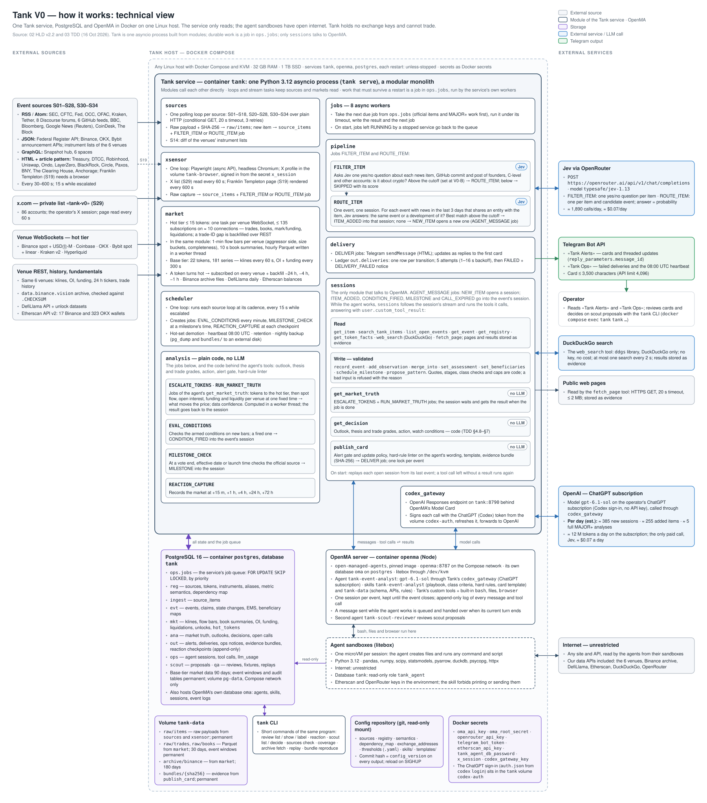

# Tank V0 — Major Event Hunter
## System Architecture (HLD)

| | |
|---|---|
| Document | 02 of 3 — HLD (the service and its modules, endpoints, data flows, storage, deployment) |
| Companions | 01 — PRD · 03 — Technical Design |
| Version | 2.2 — fixed MVP baseline |
| Date | 2026-10-16 |
| Scope | Tank V0 only (V0.4) |
| Verification | Endpoints, response fields, link patterns, limits and feed coverage below were called or read live on 16 Oct 2026, 14:00–16:30 UTC. |

---

## 1. Topology

One Linux host runs everything in Docker Compose, five containers in all: the Tank service — one asynchronous Python process built from modules (§5) — in `tank`; `tank-capture`, a Go service and the only process that talks to the exchanges (§5.1), in `tank-capture`; ClickHouse, which holds all exchange market history, in `clickhouse`; PostgreSQL, which holds everything else, in `postgres`; and the OpenMA server that hosts the agent sessions and their sandboxes in `openma`. Data lives in Docker volumes. Nothing depends on the host beyond Docker and KVM for the sandboxes (§8). Tank and tank-capture only read from the outside world (HTTPS/WSS); the agents' sandboxes have unrestricted internet access (§11).



*Technical view: the Tank service and its modules, tank-capture, ClickHouse, PostgreSQL, OpenMA, files, external sources and services. Modules call each other inside the service; Tank and tank-capture share state only through tables; work that must survive a restart is a job in PostgreSQL (§5), and only the `sessions` module talks to OpenMA. Data flows: §6.*

---

## 2. Design rules

1. Adapters isolate each source; everything downstream reads canonical rows: market data from ClickHouse, everything else from PostgreSQL.
2. Raw first: every payload is written to disk with SHA-256 before parsing.
3. Native units and per-venue data first; venue fields are read by the semantics registry (03 §2.10), and composites combine only fields of the same meaning and unit.
4. One frozen cutoff per analysis; every value carries observation time and precision.
5. Missing is never zero; exclusions carry reasons.
6. One agent session per event reads, analyzes and judges — in its own sandbox it may write files and run any command or script — but changes Tank's state only through Tank's tools, and every tool validates its input. What Tank tells the agent is text without record IDs; tool arguments name stored records by their IDs, which the agent reads from Tank's data, and Tank checks every one (03 §3.2). Market Truth, Outlook, grades, actions and the card gate are code behind those tools and contain no LLM calls.
7. Cards only for MAJOR+ events and material changes.
8. Append-only audit tables; content-addressed evidence bundles.
9. Every escalation, retry and scheduled capture has an expiry.
10. Tokens are identified by contract (03 §2.11), never by ticker.
11. No silent fallbacks: when a dependency fails, the step waits and retries, and missing data shows as n/a with the reason. Tank never switches on its own to a broader, cheaper or proxy path (01 §9, Failures).
12. One service, one capture process: Tank is a single asyncio process built from modules. Beside it run tank-capture (exchange market data, §5.1), ClickHouse, PostgreSQL and OpenMA, each in its own container. Tank and tank-capture exchange nothing but table rows. Every piece of work that must survive a restart is a job in PostgreSQL (§5).

---

## 3. Information source catalog (S01–S34)

Common to all HTTP sources: header `User-Agent: TankV0/1.0 (<operator contact e-mail>)`; conditional GET (`If-None-Match` / `If-Modified-Since`) where the server returns `ETag` / `Last-Modified`; timeout 20 s; 3 retries with 2/4/8 s backoff; escalated interval 15 s (01 FR-D-02). Each payload is stored raw with SHA-256 before parsing; items are deduplicated by the item key in the tables below. Requests to exchange hosts — the announcement APIs of S09–S11 and the instrument lists of S14 — are sent by tank-capture, not by Tank: the `sources` loop writes an `HTTP_FETCH` row to `mkt.capture_requests`, tank-capture sends it within the shared venue budget and stores the response in that row, and `sources` parses it as usual (§5.1).

HTML page sources: Tank collects every link on the page that matches the source's article pattern below, resolves it to an absolute URL, and treats each URL not seen before as a new item; the article page is then fetched for its full text. Zero matches on a successful fetch marks the source DEGRADED (layout change). Every source works from plain HTTP; Tank runs no browser. S19 reads the JSON search behind its page.

### 3.1 Regulators and market structure (CORE)

| ID | Endpoint(s) | Format | Item key | Fields parsed | Interval |
|---|---|---|---|---|---|
| S01 | `https://www.sec.gov/news/pressreleases.rss` · `https://www.sec.gov/news/speeches-statements.rss` | RSS | `guid` | title, link, pubDate, description; full text fetched from `link` | 60 s · 120 s |
| S02 | `https://www.sec.gov/cgi-bin/browse-edgar?action=getcurrent&type=S-1&owner=include&count=40&output=atom` | Atom | entry `id` (accession) | title, updated, link, summary; kept only when the filer name or title matches the registry, or contains "Trust"/"ETF" together with a crypto term | 120 s |
| S03 | `https://www.federalregister.gov/api/v1/documents.json?conditions[agencies][]=securities-and-exchange-commission&conditions[agencies][]=commodity-futures-trading-commission&conditions[agencies][]=federal-reserve-system&conditions[agencies][]=comptroller-of-the-currency&conditions[agencies][]=treasury-department&conditions[agencies][]=financial-crimes-enforcement-network&conditions[agencies][]=foreign-assets-control-office&conditions[agencies][]=federal-deposit-insurance-corporation&conditions[term]={term}&order=newest&per_page=20` — one request per term: `crypto`, `"digital asset"`, `bitcoin`, `ether`, `stablecoin`, `tokenized` | JSON | `document_number` | title, type (Rule / Proposed Rule / Notice), abstract, html_url, pdf_url, publication_date, agencies, excerpts | 300 s |
| S04 | `https://www.cftc.gov/RSS/RSSGP/rssgp.xml` · `https://www.cftc.gov/RSS/RSSENF/rssenf.xml` | RSS | `guid` | title, link, pubDate | 120 s · 300 s |
| S05 | `https://www.federalreserve.gov/feeds/press_all.xml` | RSS | `guid` | title, link, pubDate, description | 120 s |
| S06 | `https://www.occ.gov/rss/occ_news.xml` | RSS | `guid` | title, link, pubDate | 300 s |
| S07 | `https://home.treasury.gov/news/press-releases` (response ≈ 8 s) · `https://ofac.treasury.gov/rss.xml` (≈ 11 s) | HTML page · RSS | article URL · `guid` | Article pattern `^/news/press-releases/[a-z]{2}\d{4}/?$` (e.g. `/news/press-releases/sb0661`) · title, link, pubDate, description | 300 s |
| S08 | `https://www.dtcc.com/press-releases` (`/news` now redirects to Insights; checked 19 Oct 2026) | HTML page | article URL | Article pattern `https://www.dtcc.com/press-releases/\d{4}/[a-z0-9-]+` (e.g. `/press-releases/2026/dtcc-turns-tokenization-into-reality`) | 300 s |

### 3.2 Exchanges and brokers (CORE)

| ID | Endpoint(s) | Format | Item key | Fields parsed | Interval |
|---|---|---|---|---|---|
| S09 | List: `https://www.binance.com/bapi/composite/v1/public/cms/article/list/query?type=1&catalogId={48,161,49}&pageNo=1&pageSize=20` (48 New Cryptocurrency Listing, 161 Delisting, 49 Latest Binance News). Detail: `https://www.binance.com/bapi/composite/v1/public/cms/article/detail/query?articleCode={code}` | JSON | `code` | list: `id`, `code`, `title`, `releaseDate` (ms); detail: `title`, `body`, `publishDate`, catalog names | 30 s |
| S10 | `https://www.okx.com/api/v5/support/announcements?annType={type}` for `announcements-new-listings`, `announcements-delistings`, `announcements-trading-updates`, `latest-events` | JSON | `url` + `pTime` | `annType`, `title`, `url`, `pTime`, `businessPTime` (ms) | 60 s |
| S11 | `https://api.bybit.com/v5/announcements/index?locale=en-US&type={type}&limit=20` for `new_crypto`, `delistings`, `latest_bybit_news` | JSON | `url` | `title`, `description`, `type.key`, `tags`, `url`, `dateTimestamp`, `publishTime` (ms) | 60 s |
| S12 | `https://blog.kraken.com/feed` | RSS | `guid` | title, link, pubDate, categories, content | 120 s |
| S13 | `https://robinhood.com/newsroom/` (moved from `newsroom.aboutrobinhood.com`; checked 19 Oct 2026) | HTML page | article URL | Article pattern `^/(?:us/en/)?newsroom/(?!category/)[A-Za-z0-9-]+/?$` (e.g. `/us/en/newsroom/hood-summit-2026`) | 300 s |
| S14 | Binance `https://api.binance.com/api/v3/exchangeInfo` + `https://fapi.binance.com/fapi/v1/exchangeInfo`; Coinbase `https://api.exchange.coinbase.com/products`; Kraken `https://api.kraken.com/0/public/AssetPairs`; OKX `https://www.okx.com/api/v5/public/instruments?instType=SPOT` and `instType=SWAP`; Bybit `https://api.bybit.com/v5/market/instruments-info?category=spot` and `category=linear` (`limit=1000`); Hyperliquid `POST https://api.hyperliquid.xyz/info` body `{"type":"meta"}` | JSON | venue + symbol + status | symbol, base, quote, status / state, contract type; diff against the previous snapshot | 60 s (Kraken 120 s) |

### 3.3 Protocols and issuers (CORE)

| ID | Page | Article pattern (example match on 16 Oct 2026) | Interval |
|---|---|---|---|
| S15 | `https://blog.uniswap.org/` | `^/(?!category/)[a-z0-9-]{8,}$` (`/uniswap-is-live-on-arc`) | 600 s |
| S16 | `https://ondo.finance/blog` | `^/blog/[a-z0-9-]+$` (`/blog/introducing-ondo-private-markets`) | 600 s |
| S17 | `https://layerzero.network/blog` | `^/blog/[a-z0-9-]+$` (`/blog/introducing-atlas`) | 600 s |
| S18 | `https://www.blackrock.com/corporate/newsroom/media/press-releases` | `/corporate/newsroom/media/press-releases/[a-z0-9-]+` (`…/blackrock-reports-third-quarter-2026`) | 600 s |
| S19 | `POST https://www.franklintempleton.com/api/articleApi` (form: `articleType=press-release`, filter `pressReleaseCategory.exact=news-room`, `en-US`, newest 24) — the JSON search the press-releases page uses; each hit carries title, URL, reference date and full text (`contentString`) | press release URL | 600 s |
| S20 | `https://www.circle.com/pressroom` | `^/pressroom/[a-z0-9-]+$` (`/pressroom/circle-to-announce-q3-2026-financial-results-on-november-4-2026`) | 600 s |
| S21 | `https://tether.io/feed/` — RSS, item key `guid` | — | 300 s |
| S22 | `https://www.paxos.com/newsroom` | `^/newsroom/[a-z0-9-]+$` (`/newsroom/paxos-joins-solana-developer-platform`) | 600 s |

### 3.4 Governance (CORE)

| ID | Endpoint(s) | Format | Item key | Fields parsed | Interval |
|---|---|---|---|---|---|
| S23 | `https://gov.uniswap.org/latest.rss`, `https://governance.aave.com/latest.rss`, `https://gov.ethenafoundation.com/latest.rss`, `https://forum.cow.fi/latest.rss`, `https://forum.morpho.org/latest.rss`, `https://forum.euler.finance/latest.rss`, `https://gov.1inch.network/latest.rss` (moved from `gov.1inch.io`), `https://gov.near.org/latest.rss` | RSS (Discourse) | topic URL | title, link, pubDate, category, first-post text; only topics not seen before | 300 s (Euler, 1inch, NEAR: 600 s) |
| S24 | `POST https://hub.snapshot.org/graphql` — `proposals(first: 20, where: {space_in: ["uniswapgovernance.eth","aavedao.eth","cakevote.eth","cow.eth","morpho.eth","1inch.eth"]}, orderBy: "created", orderDirection: desc) { id title body state start end scores scores_total space { id } }` | GraphQL | `id` (+ `state`) | new proposals; state changes (`active` → `closed`) and final scores become STATE_UPDATE items; `end` schedules a milestone check | 120 s |

### 3.5 Technical artifacts (SECONDARY)

| ID | Endpoint(s) | Format | Item key | Interval |
|---|---|---|---|---|
| S25 | Releases: `https://github.com/Uniswap/v4-core/releases.atom`, `https://github.com/aave-dao/aave-v3-origin/releases.atom`, `https://github.com/cowprotocol/services/releases.atom`, `https://github.com/hyperliquid-dex/hyperliquid-python-sdk/releases.atom`, `https://github.com/1inch/swap-vm/releases.atom`, `https://github.com/elliottech/lighter-python/releases.atom`, `https://github.com/ava-labs/avalanchego/releases.atom`, `https://github.com/near/nearcore/releases.atom`, `https://github.com/worldcoin/world-chain/releases.atom`, `https://github.com/PlasmaLaboratories/node-templates/releases.atom`. Commits: `https://github.com/LayerZero-Labs/LayerZero-v2/commits/main.atom`, `https://github.com/morpho-org/morpho-blue/commits/main.atom` | Atom | entry `id` | 600 s |

Feeds checked on 16 Oct 2026: every release feed above except Uniswap v4-core (last release Jan 2025, kept for the next protocol version) had releases in 2026; Morpho Blue commits are active (latest 16 Oct 2026), LayerZero v2 commits are quiet (latest Feb 2026). Repositories checked and left out because they had no release in 2026: PancakeSwap `infinity-core`, Aerodrome `slipstream` and `contracts`, Curve `curve-stablecoin`, 0x `0x-settler`, Euler `evk-periphery` and `euler-vault-kit`, Ondo `rwa-contracts`, Ethena `ethena-minting-client`; Quant's public repositories are forks and tools.

GitHub evidence is SOURCE_SIDE_SUPPORT: it can raise an integration claim to BUILT at most (03 §3.6).

### 3.6 Institutional and custody (SECONDARY)

| ID | Page | Article pattern (example match on 16 Oct 2026) | Interval |
|---|---|---|---|
| S26 | `https://www.bny.com/corporate/global/en/about-us/newsroom.html` | `/corporate/global/en/about-us/newsroom/press-release/[a-z0-9-]+\.html` (`…/bny-reports-third-quarter-2026-results-130478.html`) | 600 s |
| S27 | `https://www.theclearinghouse.org/About/Media/press-releases` | `/payment-systems/Articles/\d{4}/\d{2}/[A-Za-z0-9-]+` (`/payment-systems/Articles/2026/09/The-Clearing-House-Partners-with-Quant-to-Advance-the--On-Chain-Money-Initiative`) | 600 s |
| S28 | `https://www.anchorage.com/insights` | `^/press-room/[a-z0-9-]+$` (`/press-room/the-lifecycle-of-staked-eth`) | 600 s |

### 3.7 X (S29, SECONDARY)

- X always runs; there is no switch to turn it off. Every environment needs `APIFY_API_TOKEN` in `.env`.
- Account set: the 86 handles in 01 §4.3, listed as `x_accounts` in `registry.yaml`.
- Reader: the `xsensor` module makes one synchronous run of the Apify actor `fdfsfsdfasfa/tank-x-notifier` (build `direct`) every 120 s through its run-sync URL in `sources.yaml`, sending the handles and the per-account cursors; no X account or session. The actor reads each account's public profile page signed out and returns every visible own post, usually the latest five per account (no reposts, no protected accounts), the next cursors and per-account health.
- Per post: status ID, author handle, text, exact publish time and post URL; the raw evidence is the actor response. The first run for an account only records its cursor, so posts from before Tank watched it are never ingested; later, a post is new when its ID is above the cursor. Cursors move only after the posts are stored. Failed accounts, history gaps (more posts between runs than a profile shows) and a degraded run mark S29 DEGRADED; a failed run keeps the cursors.
- Handle check: `tank sources check` calls `https://publish.twitter.com/oembed?url=https://x.com/{handle}` for each handle (follows the redirect to `publish.x.com`; HTTP 200 = exists) and confirms the owner from the profile bio (`https://syndication.twitter.com/srv/timeline-profile/screen-name/{handle}`, rate-limited to a few requests per minute) or from the person's IQ.wiki, Wikidata or GitHub profile; all 86 passed on 16–17 Oct 2026 (e.g. @el33th4xor bio: "Founder and CEO @avalabs"; @vnovakovski: IQ.wiki "founder and CEO of Lighter"; @fleupold_: Devcon speaker page and GitHub bio "Technical lead at CowProtocol"). Organization handles were taken from the project's own website, docs or GitHub organization; people's handles from the official team page, IQ.wiki, Wikidata, GitHub or reputable news. Handles that must not be used: wrong person — @nathanallman (an unrelated account; Ondo's founder Nathan Allman used @nathanlallman and died on 25 May 2026); unconfirmed or squatted — @fleupold (Felix Leupold is @fleupold_), @CoWDAO, @HyperFoundation, @HyperliquidLabs, @worldcoin (re-registered in Mar 2026); HTTP 404 — @aerodromefi, @OndoFinance, @quant_network, @ethena_labs, @eulerlabs. Left out because no official source confirms the owner: @iliensinc (Hyperliquid co-founder), @MathisGD_ (Morpho co-founder), @chef_mochi (PancakeSwap). Left out as dormant or no longer at the project: @nearfoundation, @k06a, @PaoloTasca, @kevinsekniqi, @Tederminant, @John1wu.
- Transient profile-read failures get up to three attempts for the same account within one actor run: the first immediately, the second after 1 second, the third after another 5 seconds; stop on success. Retryable HTTP statuses are 408, 429 and 5xx, plus transient connection failures. Preserve the account cursor when all attempts fail and honor the existing actor deadline.
- Exhausted profile-read failures send Tank Ops the account, HTTP request method and URL, attempt outcomes, HTTP response status, diagnostic headers and response body. The profile request is GET and has no request body. Long response bodies are sent as a document rather than silently omitted from the notification; existing response-size safety bounds remain explicit. Authentication and cookie headers must not enter Ops diagnostics. A successful retry does not emit a terminal account-failure alert.
- The Apify worker source is versioned in this repository and covered by permanent CI. The existing production deploy workflow updates the actor when its source digest differs from the selected release; unchanged source does not trigger a new actor build. The actor build and Tank release must have verified provenance and compatible contracts; failed worker publication must fail deployment rather than report success. The token remains in the single production host `.env`; no manual worker publication or second secret store is introduced.
- X profile reads remain direct from Apify, without configured proxies or X sessions; these diagnostics, retries and deployment changes do not introduce proxies.
- Terms: the actor reads the public X web UI, which carries terms-of-service risk, and Apify bills each run (recorded in `terms_notes`).

### 3.8 News (SECONDARY)

| ID | Endpoint(s) | Interval |
|---|---|---|
| S30 | `https://feeds.bbci.co.uk/news/business/rss.xml` · `https://feeds.bbci.co.uk/news/technology/rss.xml` | 120 s · 300 s |
| S31 | `https://feeds.bloomberg.com/markets/news.rss` | 120 s |
| S32 | `https://news.google.com/rss/search?q=site:reuters.com+crypto&hl=en-US&gl=US&ceid=US:en` | 300 s |
| S33 | `https://www.coindesk.com/arc/outboundfeeds/rss/` | 120 s |
| S34 | `https://www.theblock.co/rss.xml` | 120 s |

All RSS; item key `guid` (else `link`); fields title, link, pubDate, description. Bloomberg headlines (paywalled) are used for discovery; facts are confirmed from primary sources.

---

## 4. Market data catalog

Every venue request and stream below is made by tank-capture (§5.1); Tank itself opens no exchange connection. Request budgets are set at ≤ 50% of each venue's documented limit and shared by both processes through one ledger (`ops.request_budget_ledger`). Binance limits below were read from `exchangeInfo.rateLimits`. Instrument symbols per venue are listed in 03 §2.11.

### 4.1 Binance Spot

| Purpose | Endpoint | Key fields |
|---|---|---|
| Hot trades | WSS `wss://data-stream.binance.vision/stream?streams={s}@aggTrade` | `a` agg ID, `p`, `q`, `f`/`l` first/last trade ID, `T` ms, `m` buyer-is-maker (`true` → aggressive SELL) |
| Hot book | WSS `{s}@depth@100ms` + snapshot `GET https://api.binance.com/api/v3/depth?symbol={S}&limit=1000` (sync by `lastUpdateId`) | bids/asks |
| Base klines | `GET https://api.binance.com/api/v3/klines?symbol={S}&interval=1m` | row: openTime, o, h, l, c, volume, closeTime, quoteVolume, trades, takerBuyBase, takerBuyQuote |
| Backfill | `GET /api/v3/aggTrades?symbol={S}&fromId=` or `startTime`/`endTime` (≤ 1 h window) | as WS |
| 24h volume | `GET /api/v3/ticker/24hr?symbol={S}` | volume, quoteVolume |
| Limits | 6,000 request weight / min / IP; Tank budget ≤ 3,000; header `X-MBX-USED-WEIGHT-1M` read on every response | — |
| Exclusion | `LITUSDT` spot history belongs to Litentry (delisted, different token): never used for LIT | — |

### 4.2 Binance USDⓈ-M Futures

| Purpose | Endpoint | Key fields |
|---|---|---|
| Hot trades | WSS `wss://fstream.binance.com/market/stream?streams={s}@aggTrade` — the market path; the old `/stream` and `/ws` paths accept connections but push no market data (checked 17 Oct 2026) | as spot |
| Mark / funding estimate | WSS `{s}@markPrice@1s` on the same `/market/stream` connection | `p` mark, `i` index, `r` current funding estimate, `T` next funding time |
| Liquidations | WSS `{s}@forceOrder` on the same `/market/stream` connection | `o.S` side, `o.q` qty, `o.ap` avg price, `o.T` — **SAMPLED**: at most the latest liquidation per symbol per 1,000 ms |
| OI now | `GET https://fapi.binance.com/fapi/v1/openInterest?symbol={S}` | `openInterest` (base units, single-sided), `time` |
| OI history | `GET /futures/data/openInterestHist?symbol={S}&period=5m` | `sumOpenInterest` (base), `sumOpenInterestValue` (USD), `timestamp`; last 30 days only |
| Funding estimate | `GET /fapi/v1/premiumIndex?symbol={S}` | `markPrice`, `indexPrice`, `lastFundingRate` (current estimate), `nextFundingTime`, `interestRate` |
| Funding settled | `GET /fapi/v1/fundingRate?symbol={S}` | `fundingTime`, `fundingRate`, `markPrice` |
| Funding interval | `GET /fapi/v1/fundingInfo` | `fundingIntervalHours` for symbols with non-default interval (default 8 h) |
| Taker volume | `GET /futures/data/takerlongshortRatio?symbol={S}&period=5m` | `buyVol`, `sellVol`, `buySellRatio` |
| Limits | 2,400 request weight / min / IP; Tank budget ≤ 1,200 | — |

### 4.3 Coinbase Exchange

| Purpose | Endpoint | Key fields |
|---|---|---|
| Hot trades | WSS `wss://ws-feed.exchange.coinbase.com` channel `matches` | `trade_id`, `side` = **maker** side (aggressor is the opposite), `size`, `price`, `time` |
| Hot book | same socket, channel `level2_batch`; `heartbeat` for sequence checks | — |
| Backfill | `GET https://api.exchange.coinbase.com/products/{id}/trades` (paginate with `after`) | `trade_id`, `side` (maker), `size`, `price`, `time` |
| Book snapshot | `GET /products/{id}/book?level=2` | — |
| 24h volume | `GET /products/{id}/stats` | — |
| Limits | Tank budget ≤ 5 requests/s | — |

### 4.4 OKX

| Purpose | Endpoint | Key fields |
|---|---|---|
| Hot trades | WSS `wss://ws.okx.com:8443/ws/v5/public` channel `trades` | `tradeId`, `px`, `sz`, `side` (taker), `ts`, `count` (pushes may aggregate one taker order) |
| Hot book | channel `books` (400 levels, CRC32 checksum) | — |
| OI | channel `open-interest`; `GET https://www.okx.com/api/v5/public/open-interest?instType=SWAP&instId={X}-USDT-SWAP` | `oi` (contracts), `oiCcy` (coin), `oiUsd`, `ts` |
| Contract size | `GET /api/v5/public/instruments?instType=SWAP&instId=` | `ctVal`, `ctMult`, `ctValCcy` (WLD-USDT-SWAP: `ctVal` = 1 WLD) |
| Funding | channel `funding-rate`; `GET /api/v5/public/funding-rate?instId=` | `fundingRate` (current period), `settFundingRate` (last settled), `settState`, `fundingTime`, `nextFundingTime`, `prevFundingTime`, `premium` |
| Funding history | `GET /api/v5/public/funding-rate-history?instId=` | `fundingRate`, `realizedRate`, `fundingTime` |
| Mark / index | channels `mark-price`, `index-tickers` | — |
| Liquidations | channel `liquidation-orders` (`instType` SWAP) | **SAMPLED** — OKX documentation: "This data doesn't represent the total number of liquidations on OKX" |
| Backfill | `GET /api/v5/market/history-trades?instId=` | as WS |

### 4.5 Bybit

| Purpose | Endpoint | Key fields |
|---|---|---|
| Hot trades | WSS `wss://stream.bybit.com/v5/public/spot` and `/v5/public/linear`, topic `publicTrade.{SYMBOL}` | `i` trade ID, `T` ms, `S` taker side, `v`, `p`, `BT` block trade |
| Hot book | topic `orderbook.200.{SYMBOL}` (spot) | — |
| Linear ticker | topic `tickers.{SYMBOL}`; `GET https://api.bybit.com/v5/market/tickers?category=linear&symbol=` | `openInterest` (**double-sided**), `openInterestValue`, `fundingRate`, `nextFundingTime`, `fundingIntervalHour`, `markPrice`, `indexPrice` |
| OI | `GET /v5/market/open-interest?category=linear&symbol={S}&intervalTime=5min` | `openInterest` and `singleOpenInterest`; observed 16 Oct 2026: `openInterest` / `singleOpenInterest` = 2.000 for BTCUSDT, ETHUSDT, WLDUSDT → Tank uses `singleOpenInterest` |
| Funding settled | `GET /v5/market/funding/history?category=linear&symbol=` | `fundingRate`, `fundingRateTimestamp` |
| Liquidations | topic `allLiquidation.{SYMBOL}` | **COMPLETE** — Bybit documentation: "push all liquidations that occur on Bybit", USDT/USDC/inverse contracts, every 500 ms |
| Backfill | `GET /v5/market/recent-trade?category=spot&symbol=` | `execId`, `price`, `size`, `side`, `time`, `seq`; last 1,000 trades only |

### 4.6 Kraken

| Purpose | Endpoint | Key fields |
|---|---|---|
| Hot trades | WSS `wss://ws.kraken.com/v2` channel `trade` | `trade_id`, `side` (taker), `qty`, `price`, `timestamp` |
| Hot book | channel `book` (depth 1000, CRC32 checksum) | — |
| Backfill | `GET https://api.kraken.com/0/public/Trades?pair={P}&since=` | row: price, volume, time (seconds, float), `b`/`s` (taker side), `l`/`m`, misc, trade_id |
| Limits | Tank budget ≤ 1 request/s | — |

### 4.7 Hyperliquid (perpetuals)

| Purpose | Endpoint | Key fields |
|---|---|---|
| Hot trades | WSS `wss://api.hyperliquid.xyz/ws` subscription `trades` | `coin`, `side` (`B` = aggressive buy, `A` = aggressive sell — measured 16 Oct 2026 on BTC, ETH, HYPE, SOL: 90% of `B` trades printed at the ask, 79% of `A` trades at the bid), `px`, `sz`, `time`, `tid` |
| Context | subscription `activeAssetCtx`; `POST https://api.hyperliquid.xyz/info` `{"type":"metaAndAssetCtxs"}` | `funding` (hourly), `openInterest` (coin units; sidedness not published → used only as per-venue % change, never summed), `markPx`, `oraclePx`, `premium`, `dayNtlVlm` |
| Funding history | `{"type":"fundingHistory","coin":"{X}","startTime":…}` | — |
| Liquidations | no public stream | NOT_SUPPORTED |

### 4.8 History, fundamentals, supply

| Source | Endpoint | Use |
|---|---|---|
| Binance public data archive | `https://data.binance.vision/data/spot/daily/klines/{S}/1m/{S}-1m-{YYYY-MM-DD}.zip`, `…/spot/daily/aggTrades/{S}/{S}-aggTrades-{date}.zip`, `…/futures/um/daily/klines/{S}/1m/…`, `…/futures/um/daily/metrics/{S}/{S}-metrics-{date}.zip` (5m OI), `…/futures/um/monthly/fundingRate/{S}/{S}-fundingRate-{YYYY-MM}.zip`; each with `.CHECKSUM` = `"<sha256>  <file name>"` | Pre-event windows older than REST retention, retro reaction checkpoints, fixture replay (03 §5.2) |
| DefiLlama API | `https://api.llama.fi/summary/fees/{protocol}?dataType=dailyFees` / `dailyRevenue` / `dailyHoldersRevenue` (`total24h`, `total30d`, `totalDataChart`); `https://stablecoins.llama.fi/stablecoincharts/{chain}`; `https://yields.llama.fi/lendBorrow` (DefiLlama shuts down the free yield endpoints `/pools` and `/chart/{pool}` on 13 Nov 2026, moving them to the paid API; Tank uses only `/lendBorrow`, which the notice does not name and which still answered on 19 Oct 2026) | Capture chain, stablecoin supply of the settlement chain, lending utilization |
| DefiLlama unlock datasets | `https://defillama-datasets.llama.fi/emissions/{slug}` (list: `…/emissionsProtocolsList`, 371 protocols on 16 Oct 2026); slugs per token in 03 §2.11; none published for 1INCH, ZRX, QNT | `unlocks` for supply context, refreshed daily |
| Exchange wallets | DefiLlama-Adapters `projects/binance/index.js` at commit `4a6ef31a4eed4f24882a7d82bff50306b40b6d6c` (17 EVM addresses) and `projects/okex/index.js` at commit `b70f0fb4dc9ff463866d676c14d21b0ed0930d76` (323 EVM addresses) → `exchange_addresses.yaml` | Exchange inventory and wallet flows (Bybit, Coinbase, Kraken: no public list → n/a) |
| Etherscan API v2 (free key) | `https://api.etherscan.io/v2/api?chainid={id}&module=account&action=tokenbalance&contractaddress={token}&address={wallet}&apikey={key}`; `action=tokentx` for transfers | Balances and transfers of the wallets above for EVM tokens of the universe |

### 4.9 Capture tiers

| Tier | Universe | What runs | Cadence |
|---|---|---|---|
| Base (always) | 22 tokens (01 §4.1) on every covered market (§4.10) | REST 1m klines; 24h tickers; OI and funding | Klines every 60 s; OI + funding every 300 s |
| Hot (escalated, max 15 tokens) | Tokens in an event's analysis set | WebSocket trades and books on every covered venue; OI + funding every 60 s; liquidations; mark/index | Streaming; book summaries every 10 s |

Load check: base tier = 181 market series (22 tokens over the venues of the coverage matrix in §4.10) → ≈ 181 kline requests/min (Binance: 43 series, ≈ 86 weight/min of a 3,000 budget); hot tier ≤ 15 tokens × 9 markets = 135 WebSocket subscriptions on ≈ 10 connections.

### 4.10 Universe coverage (16 Oct 2026)

Y = active USDT/USDC/USD market for spot, USDT-margined perpetual for perp. Regenerated by `tank coverage` at V0-A and weekly.

| Token | BN spot | CB spot | OKX spot | BY spot | KR spot | BN perp | OKX perp | BY perp | HL perp |
|---|---|---|---|---|---|---|---|---|---|
| BTC, ETH, UNI, ONDO, ZRO, CRV, AAVE, NEAR, HYPE, ENA, MORPHO, AVAX, XPL, WLD | Y | Y | Y | Y | Y | Y | Y | Y | Y |
| ZRX, 1INCH | Y | Y | Y | Y | Y | Y | Y | Y | — |
| AERO | Y | Y | — | Y | Y | Y | Y | Y | Y |
| CAKE | Y | Y | — | Y | Y | Y | — | Y | Y |
| QNT | Y | Y | — | Y | Y | Y | Y | Y | — |
| COW | Y | Y | — | — | Y | Y | — | Y | — |
| EUL | Y | Y | — | — | Y | Y | — | Y | — |
| LIT | — | — | Y | Y | Y | Y | Y | Y | Y |

Every token has at least three spot venues and two perpetual venues. Binance spot `LITUSDT` is excluded (Litentry history, §4.1).

---

## 5. Service and modules (Python 3.13, asyncio)

Tank is one service: a single Python 3.13 asyncio process, `tank serve`, built as a modular monolith. Modules call each other directly. Long-lived loops read the sources; the exchange streams and pollers run in tank-capture (§5.1). Every piece of work that must survive a restart or wait for its turn is a job in PostgreSQL (`ops.jobs`), run by the service's own async workers (03 §3.8). CPU-heavy steps (Market Truth) run in a thread pool, so ingestion never stalls.

| Module | Libraries | Runs as | Responsibility |
|---|---|---|---|
| `sources` | `httpx`, `feedparser`, `selectolax` | One polling loop per source | S01–S28, S30–S34 at each source's cadence (15 s while escalated): conditional GET (exchange hosts through tank-capture, §3), raw capture, `source_items` row + FILTER_ITEM or ROUTE_ITEM job; S14 diffs |
| `xsensor` | `httpx`, `pydantic` | One Apify actor run per pass | S29 (the 86 X accounts, every 120 s): raw capture, `source_items` row + FILTER_ITEM or ROUTE_ITEM job |
| `market` | `httpx` | Hot-set loop; supply loop | The hot set and what tank-capture must do for it: escalation and demotion in `mkt.hot_tokens`, pre-event backfill obligations in `mkt.backfill_runs` and window repairs before a Market Truth run in `mkt.capture_requests`, each waited on until tank-capture reports it done or failed. The snapshots Market Truth reads from ClickHouse. Supply context: DefiLlama (unlock datasets daily, fees, lending, stablecoins) and Etherscan. It opens no exchange connection |
| `jobs` | `psycopg` | 8 async workers | Claim the next due job from `ops.jobs` by priority, run it under its timeout, write the result and the next job; on start, return jobs left RUNNING to the queue |
| `pipeline` | `httpx` | FILTER_ITEM and ROUTE_ITEM jobs | Decision-1 filter and routing (03 §3.1); a routed item becomes an AGENT_MESSAGE job |
| `sessions` | `httpx`, `httpx-sse`, `ddgs` | AGENT_MESSAGE and SCOUT_REVIEW jobs; one stream task per working session | The only module that talks to OpenMA: opens one session per event and posts its messages (03 §3.2); follows a session's stream while the agent works; runs each custom tool the agent calls against PostgreSQL, DuckDuckGo and the web, and answers with `user.custom_tool_result`; a slow tool (`get_market_truth`) is answered when its job finishes; posts a reader's Telegram reply from "Tank Alerts" or "Tank Ops" into the session that handled the event or material (01 FR-P-03) |
| `codex_gateway` | `httpx` | An HTTP endpoint on the Compose network (`http://tank:8790/v1`) | The model endpoint behind OpenMA's Model Card for `gpt-6.1-sol` (OpenAI Responses API): checks the internal key, adds the operator's ChatGPT (Codex) OAuth token and account id from the volume `codex-auth`, and forwards the call to the endpoint the Codex CLI uses; when the token expires it refreshes it with the refresh token and writes the new tokens back; a usage-limit answer goes back to OpenMA with its reset time |
| `analysis` | `numpy`, `pandas` | ESCALATE_TOKENS, RUN_MARKET_TRUTH, EVAL_CONDITIONS, MILESTONE_CHECK and REACTION_CAPTURE jobs; the code behind the tools | State Tracker, EMS checks, Beneficiary rules, Market Truth, Outlook, Decision Engine, Alert Composer, evidence bundles; no LLM |
| `delivery` | `httpx` | DELIVER jobs | Telegram send, threading, ledger; "Tank Ops" notices: the processing card of each material (sent once, then edited in place), entry-error notices with their diagnostic documents, DELIVERY_FAILED, the heartbeat (03 §7.6) |
| `scheduler` | — | One loop | Runs each source loop at its cadence (normal or 15 s escalated); creates EVAL_CONDITIONS every minute, MILESTONE_CHECK at a milestone's time and REACTION_CAPTURE at each checkpoint; hot-set demotion; heartbeat notice; retention; nightly backup (`pg_dump` and `bundles/` to an external disk) |
| CLI | `click` | Short commands of the same program | Review, scout decisions, replay, archive fetch, bundle reproduction, source and handle checks |

Next to the service run four containers: `tank-capture` (§5.1), `clickhouse` (ClickHouse; database `mkt`, the exchange market series and every print, written only by tank-capture), `postgres` (PostgreSQL 16; database `tank`, plus OpenMA's database `oma`) and `openma`, the OpenMA server (`open-managed-agents` built from a pinned upstream commit with Tank's patches, §8; Node.js), listening on port 8787 of the Compose network. It hosts the agents `tank-event-analyst` and `tank-scout-reviewer` and their sessions, makes the model calls through Tank's `codex_gateway`, which signs them with the operator's ChatGPT subscription (Codex sign-in, §8), inlines the skills and keeps the append-only session logs. Each session gets its own litebox sandbox, a microVM with unrestricted internet access and read-only access to the database `tank` (§8).

On start, the service returns jobs left RUNNING to the queue, re-reads the hot set in `mkt.hot_tokens` and re-creates its missing backfill obligations, replays each open session's stream from its last stored event and keeps following the sessions still at work. A tool call left without a result runs again; a write tool that already ran returns its stored result (03 §3.2), so a restart loses nothing and writes nothing twice.

### 5.1 tank-capture (Go)

`tank-capture` is the only process that talks to the exchanges. It is a static Go binary (`capture/`, `cmd/tank-capture`) in its own container, with the versioned configuration baked into its image; from the host `.env` it receives only the database password. It holds the venue WebSocket streams, repairs trade-ID gaps over REST, polls klines, 24h tickers, open interest and funding, builds the 1-minute flow bars and 10-second book summaries with their completeness proofs, and writes them and every print into ClickHouse `mkt`. It also sends every other request to an exchange host on Tank's behalf (§3). Tank reads market data from ClickHouse only and starts no stream, poller, backfill or exchange request itself.

The interface between the two processes is tables; no files pass between them:

| Table | Store | Written by | Read by | Purpose |
|---|---|---|---|---|
| `mkt.klines_1m`, `mkt.flow_bars_1m`, `mkt.book_summaries`, `mkt.oi_obs`, `mkt.funding_obs`, `mkt.liq_obs`, `mkt.tickers_24h` | ClickHouse | tank-capture | Tank | Market series (ReplacingMergeTree, read with `FINAL`) |
| `mkt.trades` | ClickHouse | tank-capture | Tank, agents | Every print |
| `mkt.hot_tokens` | PostgreSQL | Tank | tank-capture | The hot set tank-capture subscribes |
| `mkt.backfill_runs` | PostgreSQL | Tank creates, tank-capture runs | Tank | Pre-event backfill obligations and their readiness |
| `mkt.capture_requests` | PostgreSQL | Tank creates, tank-capture runs | Tank | Window repairs before a Market Truth run; `HTTP_FETCH` requests to exchange hosts with their stored responses |
| `mkt.capture_streams`, `mkt.capture_gaps` | PostgreSQL | tank-capture | Tank | Stream state per instrument (Data Confidence) and explicit gap evidence |
| `ops.request_budget_ledger`, `ops.request_budget_blocks` | PostgreSQL | both | both | One request budget per provider and IP; a 429 or 418 closes the host for both processes |

- **Single writer.** tank-capture holds the PostgreSQL advisory lock `tank:capture:writer` on a dedicated connection and is the only writer of the market tables; while the lock is lost, flushes keep their rows in memory, so nothing is written without the lock and nothing is dropped.
- **Completeness.** A flow bar is sealed only when the minute's prints form one proven chain (consecutive trade IDs, or one uninterrupted connection where a venue has no consecutive IDs) and a later print or a head check proves the minute closed; a hole is repaired over REST by trade ID, and a minute REST cannot fill is sealed incomplete with its reason. A late print rewrites a sealed bar as a new revision; a complete bar is never replaced by an incomplete one.
- **Restart.** tank-capture resumes from ClickHouse (the newest bar with a print is the trade cursor) and repairs the gap to the first print of the new socket over REST; nothing is re-parsed. A deploy replaces it make-before-break, so no minute of prints is lost (§8).
- **Health.** `GET /healthz` on port 8791 inside the container (200 while the writer lock is held and the last flush is recent), `/readyz`, `/status`; no port is published.
- **Parity.** Its parsing, normalization, bars and book summaries are ports of the Python reference `tank.market`; a parity harness feeds both the same recorded frames and requires identical trades, rows, bars and watermarks (`capture/README.md`).

---

## 6. Data flows

### 6.1 New item → card

```mermaid
sequenceDiagram
  autonumber
  participant SRC as Source (e.g. S09 Binance)
  participant ING as tank · sources
  participant DB as PostgreSQL
  participant CH as ClickHouse
  participant JOB as tank · job workers
  participant DEC as Decision-1 (Azure Foundry)
  participant SES as tank · sessions
  participant OMA as OpenMA (agent session)
  participant MKT as tank · market
  participant CAP as tank-capture
  participant TG as Telegram

  SRC->>ING: new article code in catalog 48 (exchange host, fetched through tank-capture)
  ING->>DB: raw + source_items row (observed_at) + FILTER_ITEM or ROUTE_ITEM job
  opt news, a GitHub commit or an X post outside the organization accounts
    JOB->>DEC: FILTER_ITEM — about crypto at all? (probability)
  end
  JOB->>DEC: ROUTE_ITEM — the same event as one with news in the last 3 days? (per candidate)
  alt no matching event
    JOB->>DB: AGENT_MESSAGE job NEW_ITEM
    SES->>OMA: create the session + user.message (the item)
  else matches event E
    JOB->>DB: AGENT_MESSAGE job ITEM_ADDED
    SES->>OMA: user.message into E's session (queued while the agent works)
  end
  OMA->>SES: tool calls: record_event, set_assessment
  SES->>DB: validate and write; results back to the session
  alt STRUCTURAL SHOCK
    OMA->>SES: publish_card PARTIAL
    SES->>DB: alert + DELIVER job
    JOB->>TG: sendRichMessage
  end
  OMA->>SES: set_beneficiaries, get_market_truth
  SES->>DB: ESCALATE_TOKENS and RUN_MARKET_TRUTH jobs
  JOB->>MKT: ESCALATE_TOKENS
  MKT->>DB: mkt.hot_tokens + mkt.backfill_runs (backfill −24h)
  CAP->>DB: reads the hot set and the obligation
  CAP->>CH: subscribes every covered market, backfills: flow bars, prints, books, OI, funding, liquidations
  JOB->>CH: RUN_MARKET_TRUTH reads the snapshot
  JOB->>DB: Market Truth (no LLM)
  SES->>OMA: get_market_truth result
  OMA->>SES: get_decision, publish_card FULL
  SES->>DB: outlook, grades, action (code); gate; alert + DELIVER job
  JOB->>TG: sendRichMessage (or reply to the partial)
  JOB->>DB: ledger SENT with message_id
```

### 6.2 Market data

Inside tank-capture (§5.1), one task per WebSocket connection: messages → per-venue parser applies semantics (aggressor side, units) → dedup by trade ID → 1m flow bar per venue/instrument (sealed complete only when the minute's prints form one proven chain, §5.1) → ClickHouse: the bar rows and every print (`mkt.trades`). Book diffs → in-memory book per venue → 10 s summaries (spread, depth bands, covered range). Its REST pollers write klines, OI, funding and 24h volumes to ClickHouse. Tank's `market` module only reads these tables.

### 6.3 Re-evaluation

A new item about the event reaches its session as ITEM_ADDED; a fired watch condition, a milestone outcome or an expiring call reaches it as CONDITION_FIRED, MILESTONE or CALL_EXPIRED. The agent calls `get_market_truth` at a new cutoff when it needs one, then `get_decision` and `publish_card` UPDATE; the update policy sends a threaded update only on a material change (01 FR-A-04).

### 6.4 Reaction windows

A MAJOR+ class from the agent's `set_assessment` → pre-event windows computed from base tier + archive → `REACTION_CAPTURE` jobs at +15m, +1h, +4h, +24h, +72h from the anchor (created by the scheduler, run by the job workers, no LLM) → frozen checkpoint rows.

---

## 7. Storage

### 7.1 Databases: PostgreSQL 16 (database `tank`) and ClickHouse (database `mkt`)

| Schema | Tables | Retention |
|---|---|---|
| `reg` | `sources`, `entities`, `entity_aliases`, `tokens`, `instruments`, `sector_baskets`, `dependency_map`, `metric_semantics`, `exchange_addresses` | Versioned with config |
| `ingest` | `source_items` | Permanent |
| `evt` | `events`, `event_entities`, `event_observations`, `claims`, `state_changes`, `ems_assessments`, `capture_chains`, `beneficiary_maps`, `beneficiary_edges` | Permanent |
| `mkt` (PostgreSQL) | `unlocks`, `hot_tokens`, capture coordination with tank-capture (`backfill_runs`, `capture_requests`, `capture_streams`, `capture_gaps`, §5.1) | Permanent / as declared |
| `mkt` (ClickHouse) | `klines_1m`, `flow_bars_1m`, `book_summaries`, `oi_obs`, `funding_obs`, `liq_obs`, `tickers_24h`, `trades` — written only by tank-capture | ReplacingMergeTree on the row identity (the last write wins), daily partitions, ZSTD/DoubleDelta codecs; base tier 90 days, `trades` 30 days, `book_summaries` 72 hours (summary fields only, no order-book levels); days overlapping a MAJOR+ event window kept permanently (except book summaries). Agents read it with a read-only user. |
| `ana` | `market_truth`, `outlooks`, `decisions`, `contradictions`, `watch_conditions`, `calls` | Permanent |
| `out` | `alerts`, `deliveries`, `ops_notices`, `evidence_bundles`, `reaction_checkpoints`; `ops_cards` (the "Tank Ops" processing card of each material and its Telegram message, edited in place) | Permanent, append-only; `ops_cards` mutable |
| `ops` | `jobs`, `agent_sessions`, `tool_calls`, `llm_usage`, `request_budget_ledger`, `request_budget_blocks` (the venue request budget shared with tank-capture) | Jobs 30 days; LLM usage permanent |
| `scout` | `expansion_proposals` | Permanent |
| `qa` | `reviews`, `fixtures`, `replay_runs` | Permanent |
| `oma` (OpenMA's own database) | Agents, skills, sessions and their append-only event logs | Permanent |

DDL for the core tables is in 03 §14.

### 7.2 Files (volume `tank-data`, mounted at `/data`)

| Path | Content | Retention |
|---|---|---|
| `raw/items/{source_id}/{yyyy}/{mm}/{dd}/{item_id}.json.zst` | Raw payloads | Permanent |
| — | Order-book levels are not stored (§7.1) | — |
| `archive/binance/…` | Downloaded archive files + `.CHECKSUM` | Cache, 180 days |
| `bundles/{sha256}.json.zst` | Evidence bundles | Permanent |

Sizing estimate (ClickHouse): prints ≈ 0.5 GB/day compressed at 15 hot tokens; book summaries ≈ 0.3 GB/day; base-tier series ≈ 30 MB/day. A 1 TB SSD holds well over a year at this rate.

---

## 8. Runtime and deployment

| Item | V0 setting |
|---|---|
| Host | Any Linux server (x86-64 or arm64) with Docker Engine, Compose v2 and KVM (`/dev/kvm`) for OpenMA's sandboxes; 32 GB RAM, 1 TB SSD, wired network |
| Services | `compose.yaml` with five services, each `restart: unless-stopped`: `tank` runs `tank serve`, `tank-capture` runs the exchange capture, `openma` runs the OpenMA server, `postgres` runs PostgreSQL, `clickhouse` runs ClickHouse; logs through Docker's logging driver with rotation; Compose network `172.30.60.0/24`, OpenMA at the fixed address `172.30.60.10` |
| Database | Image `tank-postgres` (`postgres:16` with Tank's init script and `pg_hba.conf` baked in), data in the volume `pg-data`: the service and OpenMA connect over the Compose network; the read-only role `tank_agent` connects from the sandboxes, whose traffic leaves through OpenMA's address (`pg_hba.conf`: that role, that address, SCRAM); no port is published outside the host |
| Market database | Image `tank-clickhouse` (`clickhouse/clickhouse-server:25.8` with Tank's config and users baked in), data in the volume `clickhouse-data`, at most 40% of the host's RAM and 4 GB per query (larger GROUP BY / ORDER BY spill to disk), no container caps, `query_log` kept 3 days and no other system log tables; tank-capture writes and the service reads over HTTP on the Compose network as user `tank`; the read-only user `tank_agent` (same password as the PostgreSQL role) is accepted only from the sandboxes' address; no port is published outside the host |
| OpenMA | Container `openma` from the image `tank-openma`, built by CI from the checked-in `vendor/openma` application and its static `Dockerfile`, based on upstream `open-managed-agents` commit `85d5361f535c7221de975838dc48444e468cc02e`. Tank's compatibility changes are direct source changes in that tree; an external checkout, source generator and patch step are not part of deployment. The vendored application keeps these fixes: PostgreSQL 16 (untyped nullable query parameters, epoch timestamps stored as strings); tool arguments renamed by the case mapper (`item_id` → `itemId`); the agent tool config that cannot enable `browser` or disable the `schedule` tools; the browser running inside the session sandbox; an environment's network policy and credentials passed to the sandbox (upstream ignores networking, so the replay sandbox would have internet); custom-tool results that resume the model on the first result of a group (the session waits for every result of the tools called in one step, then resumes the model once; messages that arrive meanwhile queue in order and survive an OpenMA restart); BoxLite's file transfer, which refuses paths under the sandbox's mounts (`/tmp`, `/mnt/session/outputs`, `/replay/evidence`) because it writes to the image beneath them (OpenMA's file reads and writes run as a process inside the VM instead, BoxLite's own workaround, so the VM's mounts and permissions apply); a Dockerfile built on Node 22 although its pnpm needs Node 24; the console build, skipped with `SKIP_CONSOLE=1`. The litebox runtime is the architecture-matched BoxLite v0.10.6 native bundle under `vendor/openma/tank-native`, with source/rebuild contracts under `deploy/boxlite`; `DATABASE_URL` = database `oma` on `postgres`; `SANDBOX_PROVIDER=litebox` with `/dev/kvm` passed into the container (one libkrun microVM per session); the Model Card for `gpt-6.1-sol` is a custom provider (`pi_config.api: openai-responses`) whose `base_url` is Tank's `codex_gateway` (`http://tank:8790/v1`), called with the internal key `CODEX_GATEWAY_KEY`; OpenMA never holds the ChatGPT sign-in; port 8787 on the Compose network only; agents and skills uploaded by `tank` on start when their files changed |
| Agent sandbox | Environment `tank-analysis`: image `tank-analysis`, built from `deploy/sandbox.Dockerfile` as an OCI layout baked into the `tank-openma` image (the OpenMA API takes no image per environment): Python 3.13 with `pandas`, `numpy`, `scipy`, `statsmodels`, `duckdb`, `psycopg[binary]`, `httpx`, `websockets`; `postgresql-client`, Node.js for the pi harness tools, Playwright 1.64.0 with its Chromium and Tank's browser worker; no network allowlist or denylist; env `TANK_DB_URL` (role `tank_agent`; the same credentials open ClickHouse at `http://clickhouse:8123` read-only), `ETHERSCAN_API_KEY` and `OPENROUTER_API_KEY` — in V0 the keys sit in the environment and the skill forbids printing them or sending them anywhere but their own API; a credential vault comes with production. Environment `tank-replay` for fixture replays: the same image; the only reachable address is the replay database (its resolved private IP is the single allowlist entry), and `TANK_DB_URL` points at it (03 §11.1) |
| Images | Built by CI from the repository and pushed to GHCR, tagged with the commit SHA: `tank` (the repository's `Dockerfile`: Python, `asyncio`, dependencies pinned in `uv.lock`, the whole `config/`), `tank-capture`, `tank-openma` (with the `tank-analysis` sandbox layout), `tank-postgres`, `tank-clickhouse`; volumes `tank-data` (`/data`), `codex-auth` (the ChatGPT sign-in) and `backup` (an external disk on the host) |
| Configuration | The repository's `config/`, built into the `tank` image at `/app/config`: `sources.yaml` (incl. article patterns of §3), `semantics.yaml`, `registry.yaml` (tokens, identities, aliases, instruments, sector baskets), `dependency_map.yaml`, `exchange_addresses.yaml`, `thresholds.yaml`, `openma.yaml`, `skills/` (the agents' skills and tool schemas), `templates/`; loaded on start; a change is a commit and a deploy; the image's commit SHA is stored as `config_version` on every output |
| Secrets | One file, `/srv/tank-deploy/.env` on the production host next to `compose.yaml` and `deploy.sh`, outside the repository, owned by root with mode 0600; there are no Docker secrets and no second credential store. Compose passes each container only its variables (`.env.example` lists them): the database passwords (`POSTGRES_PASSWORD`, `TANK_DB_PASSWORD`, `OMA_DB_PASSWORD`, `TANK_AGENT_DB_PASSWORD`, `TANK_REPLAY_AGENT_DB_PASSWORD`), `OMA_API_KEY`, `OMA_ROOT_SECRET`, `OMA_AUTH_SECRET`, `TANK_FOUNDRY_API_KEY` (Decision-1), `TELEGRAM_BOT_TOKEN`, `ETHERSCAN_API_KEY`, `OPENROUTER_API_KEY` (agents' sandboxes only), `CODEX_GATEWAY_KEY`, `APIFY_API_TOKEN`; tank-capture gets only `TANK_DB_PASSWORD`. The ChatGPT sign-in sits in the `tank` volume `codex-auth` (writable: the gateway saves refreshed tokens there); the Etherscan and OpenRouter keys and the `tank_agent` password also reach the environment `tank-analysis`; never written to logs or bundles |
| Deployment | The GitHub workflow `deploy.yml`, started by hand for a commit of `main`, after that commit's CI built its images: it copies `compose.yaml` and `scripts/deploy/deploy.sh` to the host and runs it; the host pulls the images, restarts PostgreSQL, ClickHouse and OpenMA only when their image content changed, replaces `tank-capture` without losing a minute, restarts `tank` (which applies migrations and DDL and uploads changed agents and skills to OpenMA), checks the live system for up to 8 minutes and otherwise returns to the previous commit |
| Time | The host's NTP client (e.g. `chrony`); containers use the host clock |
| Backups | Nightly `pg_dump` + `bundles/` copy to the volume `backup` (an external disk on the host) |

A sandbox image upgrade continues existing non-archived sessions on the current deployed image through a fenced replacement at an idle boundary (03 §3.2, “Sandbox image upgrades and retained-session recovery”). Preserve the session ID, transcript, pending input and persistent user/browser files without copying the old operating system over the new image. Separate executable image identity from session/security compatibility; metadata-only OCI rebuilds do not invalidate retained sessions. Legacy retained sessions and inputs failed by the image mismatch have a recoverable application-managed upgrade path. An unexplained security/configuration mismatch remains a refusal, not permission to reset the session or bypass validation.

Concurrency: one asyncio event loop with 8 job workers; CPU-heavy steps run in a thread pool; sessions run in parallel inside OpenMA, one per event; `publish_card` takes one lock per event.

---

## 9. External interfaces

| Interface | Contract |
|---|---|
| External services | OpenAI (`gpt-6.1-sol`) on the operator's ChatGPT subscription — Codex sign-in, no API key — called by OpenMA through Tank's `codex_gateway` (03 §3.2); DuckDuckGo search (the `web_search` tool; no key, no official API); Microsoft Decision-1 on Azure Foundry (FILTER_ITEM and ROUTE_ITEM, `api-key`; 03 §3.1); Telegram Bot API (bot token); the Apify actor `fdfsfsdfasfa/tank-x-notifier` for S29 (API token, billed per run); Etherscan API v2 (free key); DefiLlama API and datasets (no key); venue public APIs (no keys), reached only by tank-capture (§5.1). The agents' sandboxes reach any public site and API, these included, without the Telegram bot token, the Apify token or the Foundry key (§11). |
| Telegram Bot API | sendRichMessage with structured blocks to "Tank Alerts": scores are a compact native table with full names, values and explanations. The frozen rich payload is stored with the alert and evidence bundle. Tank sets no length limit of its own; `publish_card` refuses only a card above Telegram's rich-message limits (32,768 characters, 500 blocks) and says by how much. Legacy cards and "Tank Ops" notices use sendMessage with parse_mode=HTML; the processing card of a material is edited in place with editMessageText; the HTTP responses of a failed X profile read go as documents (sendDocument) in reply to their notice. Updates use reply_parameters.message_id of the first card; the returned message_id is stored in the ledger. |
| Decision-1 via Azure Foundry | `POST <TANK_FOUNDRY_ENDPOINT>/providers/microsoft/v1/systemone` (the HTTPS origin of the Azure Foundry resource), header `api-key: <TANK_FOUNDRY_API_KEY>`, body `{model: <TANK_FOUNDRY_DEPLOYMENT, default decision-1>, state, questions}` for a deployment of Microsoft-Decision-1 version 1; one `noul` question per item (FILTER_ITEM) and per item and candidate event (ROUTE_ITEM). The answer must name the model `microsoft-decision-1` and give every question a probability between 0 and 1, or the call fails; an HTTP error is neither retried nor sent to another provider. Answers are stored on the item; usage is logged to `ops.llm_usage` with the token counts and the cost unknown, because Azure reports none (03 §3.1). The agents' sandboxes get no Foundry key. |
| OpenMA API | `http://openma:8787/v1/*` on the Compose network, with header `x-api-key`: `POST /v1/sessions`; `POST /v1/sessions/{id}/events` with `user.message` or `user.custom_tool_result`; `GET /v1/sessions/{id}/events/stream` (SSE, `Last-Event-ID` resume); `/v1/agents` and `/v1/skills` to deploy agent and skill versions (03 §3.2). OpenMA calls `gpt-6.1-sol` through Tank's `codex_gateway`; token usage from the sessions' model-request spans goes to `ops.llm_usage`. |
| DuckDuckGo search | Python library `ddgs` 9.16.0: `DDGS().text(query, backend="duckduckgo", max_results=10)`. DuckDuckGo has no official web-search API; the library reads its results page, so there is no key and no charge (01 D9). At most one search every 2 s across the service; a rate-limit, block or timeout error is retried after 5, 15 and 45 s, then the error goes back to the agent; no other engine is used. Results (title, URL, snippet) are stored as evidence; searches are counted in `ops.llm_usage`. |
| CLI | Inside the `tank` container (`docker exec tank-tank-1 tank …`): `tank review list`, `tank review show`, `tank review label`, `tank reaction`, `tank scout list`, `tank scout decide`, `tank sources check` (feeds, article patterns, X handles), `tank coverage`, `tank archive fetch {symbol} {date}`, `tank replay {fixture_id}`, `tank bundle reproduce {sha}` (01 §7.4). |

---

## 10. Failure modes and degradation

| Failure | Detection | Behavior |
|---|---|---|
| Venue WebSocket disconnect (tank-capture) | Socket closed / no message 30 s / ID gap | Reconnect with backoff; REST backfill by trade ID; minutes without full backfill sealed incomplete with the reason; the venue drops out of composites for those windows. |
| Binance archive checksum mismatch or gap | SHA-256 vs `.CHECKSUM`; continuity check | File rejected; window marked incomplete; re-download once after 1 h. |
| Agent turn error or refusal | `session.error` in the session stream | The message is sent again once; then the event is marked FAILED; no card content generated from it. |
| DuckDuckGo rate limit or block | `ddgs` rate-limit, block or timeout error | Retries after 5, 15 and 45 s; then `web_search` returns the error to the agent, and a fact it could not confirm stays MEDIUM. No other engine is used. DuckDuckGo blocks some cloud IP ranges, so a test search runs from the host before launch. |
| Telegram failure | Ledger FAILED after 5 attempts | DELIVERY_FAILED notice; the card stays GENERATED. |

---

## 11. Security

- No exchange API keys exist in V0; every market endpoint used is public, and only tank-capture calls them. The Foundry key (Decision-1), the Etherscan key and the OpenRouter key (sandboxes only) are service keys. OpenAI is reached with the operator's ChatGPT sign-in, which stays in the `tank` container (volume `codex-auth`): OpenMA and the sandboxes never see it, and `codex_gateway` answers only on the Compose network, to OpenMA's internal key.
- Secrets are variables of the host's single `.env`, passed by Compose only to the containers that use them. PostgreSQL, ClickHouse and OpenMA are reachable only on the Compose network — PostgreSQL and ClickHouse also from the sandboxes, for `tank_agent` only — and no port is published outside the host.
- Agent sandboxes: one microVM per session with unrestricted internet. Whatever the agent reads there is data, not instructions (skill `tank-data`, 03 §3.2). It reads Tank's data only as `tank_agent`, has the Etherscan and OpenRouter keys in its environment and is forbidden by the skill to print them or send them anywhere but their own API (a vault replaces this in production), holds neither the Telegram bot token, the Apify token nor the Foundry key, and changes Tank's state only through Tank's tools; cards leave only through `publish_card`.
- The Apify token (`APIFY_API_TOKEN`) is a secret; the actor only reads public X profile pages.
- Each source's terms and rate limits are recorded in `sources.yaml`; request budgets stay ≤ 50% of documented limits; sec.gov ≤ 10 requests/s with a declared User-Agent; DuckDuckGo at most one search every 2 s (no published limit; the terms-of-service risk is accepted, 01 D9).
