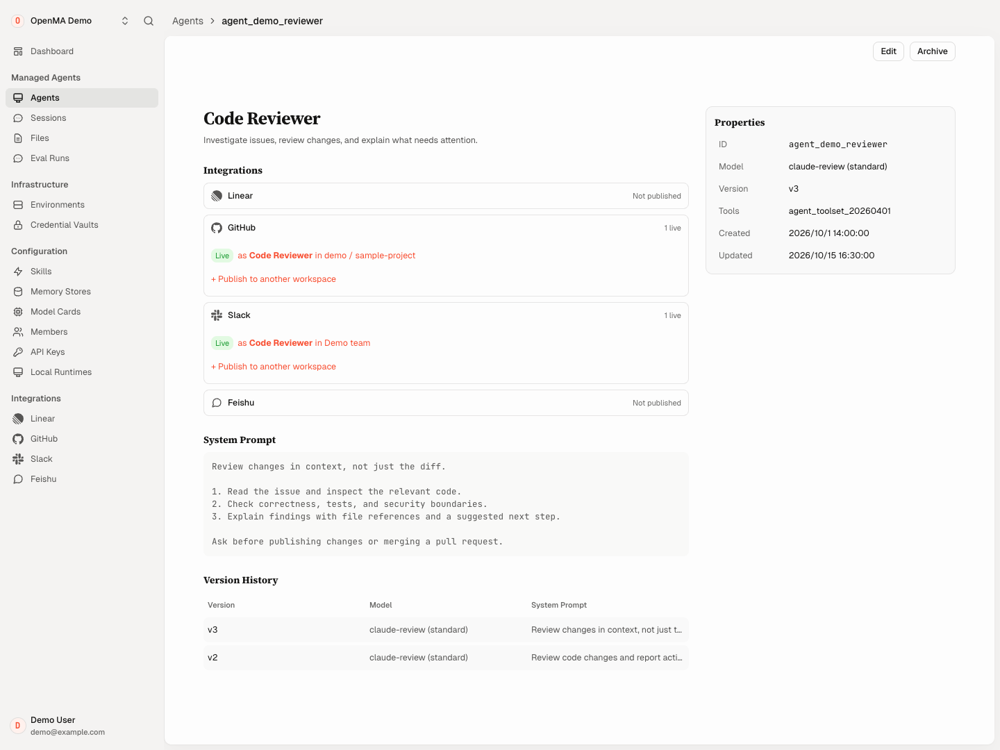
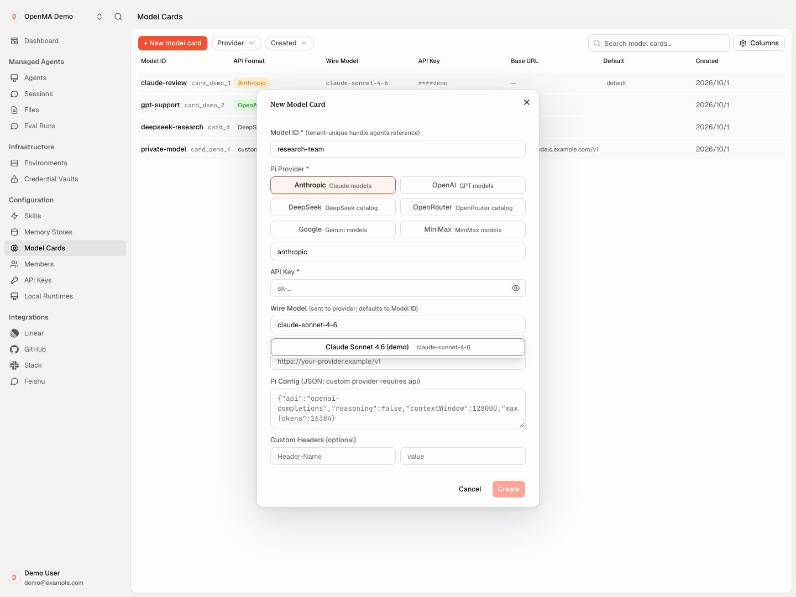
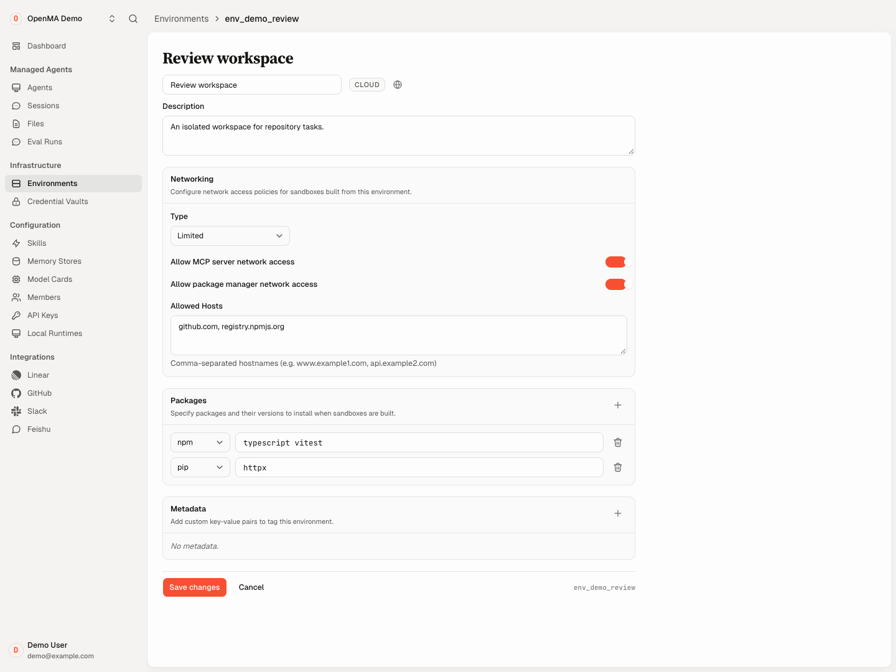

<p align="center">
  
</p>

# Open Managed Agents

**Any model. Any harness. Any sandbox. Any cloud.**

OpenMA 管理会话、执行与恢复，让你自由选择模型、harness、沙箱和部署平台，构建并运行自己的 Agent。它是 Claude Managed Agents 和 OpenAI Agents API 的开源、可自部署替代方案。

**底层基础设施，也由你选择。** 使用现成适配器，或接入你自己的数据库、队列和对象存储。

[托管试用](https://app.openma.ai/login) · [自部署](#自部署) · [For agents](#for-agents) · [API 示例](#api-与兼容范围) · [文档](https://docs.openma.ai) · [Apache-2.0](LICENSE) · [English](README.md)

[](docs/assets/console/agent-light.png)

<table>
  <tr>
    <th width="50%">模型配置</th>
    <th width="50%">执行环境</th>
  </tr>
  <tr>
    <td><a href="docs/assets/console/model-setup-light.png"></a></td>
    <td><a href="docs/assets/console/environment-light.png"></a></td>
  </tr>
</table>

*真实 Console 界面，使用合成演示数据；集成状态和配置仅供展示。点击截图可查看原图。*

## 在托管执行基础上构建 Agent

创建 Agent、交给它任务，之后回到同一个会话继续工作。OpenMA 提供：

- **持久会话与恢复。** 保存对话历史、展示流式进展、协调执行，不把会话绑在一个进程上。配置好相应运行时后，可使用工作区检查点与保留产物支持恢复。
- **可复用的工具与集成。** 从 Shell、文件、网页、浏览器工具开始，接入 MCP 和 Skills，再把 Agent 连接到团队日常使用的工作平台。
- **部署选择权。** 模型、harness、沙箱和后端服务可以独立选择，通过 Console、CLI 或 API 操作。

如果 OpenMA 对你有帮助，欢迎给仓库点 **Star**。发版通知可通过 **Watch → Custom → Releases** 订阅。

## For agents

给你的 coding agent 安装 [OpenMA 部署 Skill](skills/deploy-openma/SKILL.md)：

```bash
npx skills add openma-ai/open-managed-agents --skill deploy-openma
```

然后告诉它：**“帮我在这台机器上部署 OpenMA。”** Agent 会检查环境、准备配置、执行部署，并验证 Console 和 Agent 任务；需要你选择目标、登录或提供凭证时再询问，创建付费云资源前会确认。这条命令安装部署指南，实际部署由你随后交给 Agent 执行。

## 选择你的技术栈

| 层次 | 现有集成与扩展入口 |
| --- | --- |
| **模型** | Anthropic、OpenAI、DeepSeek、OpenRouter 等 Pi provider；通过 [Model Card](packages/sdk/README.md#pi-backed-model-cards) 配置自定义端点 |
| **Harness** | 内置 Pi；通过 [ACP 适配](packages/harness-runtime-acp/README.md) 接入 Claude Code、Codex 等 Agent；[自定义 harness](#架构平台harness-与沙箱) |
| **沙箱** | E2B、Daytona、LiteBox、Cloudflare Sandbox 等；详见[供应商能力](apps/docs/src/content/docs/self-host/managed-runtime-host.mdx) |
| **部署** | 原生 Node.js、Docker、Fly.io、Vercel（Beta）、Cloudflare；[部署入口](#自部署) |
| **数据库** | SQLite、PostgreSQL、MySQL、Cloudflare D1、Durable Object SQL 适配器；[SQL client 与 Store 接口](docs/v1-architecture.md) |
| **队列** | SQL 持久队列、Cloudflare Queues、内存适配器；[Queue 与死信合同](packages/queue/src/ports.ts) |
| **对象存储** | S3 兼容存储、Cloudflare R2、本地文件系统及内存 Blob 适配器；[BlobStore](packages/blob-store/src/ports.ts) |

使用现成适配器，或实现自己的扩展。Any 表示接口可扩展，具体功能和配置取决于所选适配器；要求见表中的供应商与部署指南。

## 架构：平台、harness 与沙箱

OpenMA 采用 **meta-harness** 架构，管理 Agent loop 周围的资源和生命周期。根据 Agent 的需要选择执行路径。

### Harness 在沙箱外：独立管理生命周期

模型循环在沙箱外运行，沙箱负责工具执行，会话历史独立于两者保存。沙箱故障不会抹掉对话，替换后的 harness 可以从持久事件重建上下文。执行资源的生命周期与 Agent loop 解耦。

使用内置 Pi，或实现[宿主侧 harness 接口](apps/agent/src/harness/interface.ts)。工作区恢复需要对应的持久化配置和供应商支持；[Runtime Host 指南](apps/docs/src/content/docs/self-host/managed-runtime-host.mdx#session-brain-placement-and-scaling) 说明了执行归属与恢复机制。

### Harness 在沙箱内：复用成熟 Agent

将 Claude Code、Codex 等已有 harness 放进托管沙箱，复用它的 Agent loop、上下文管理、工具和技能，无需重新实现这些能力。OpenMA 提供外层的工作生命周期、工作区持久化和产物收集。

[ACP runtime](packages/harness-runtime-acp/README.md) 提供现成接入，支持将版本化 harness 安装与沙箱镜像分开管理。自定义 harness 可使用 [supervisor 合同](packages/harness-supervisor/src/index.ts)，ACP 只是其中一种选项。原生功能与会话续接范围取决于所选适配器。

## 已集成的工具，更少的接入工作

| 能力 | 可以使用什么 |
| --- | --- |
| **代码与文件** | Shell 执行、文件读写与编辑、文件匹配和文本搜索 |
| **网页研究** | Web 搜索与页面抓取 |
| **浏览器自动化** | 导航、点击、输入、读取页面、截图；需显式启用并配置浏览器后端 |
| **MCP 与 Skills** | 外部工具服务和可复用指令；Pi 支持按需发现工具、加载技能 |
| **会话资源** | 关联仓库、文件和持久化 Memory Store，按会话授权访问 |
| **工作平台** | GitHub issue/PR、Linear issue、Slack 线程和飞书会话 |

将仓库工具与 GitHub 组合用于 issue 调查，或将网页工具与 Slack 组合成研究助手。把同一套工具和技能复用到更多 Agent，减少为每个工作流重新接入服务的成本。凭证和权限按要求配置；沙箱内 harness 使用自身工具及适配器提供的能力。

[内置工具](apps/agent/src/harness/tools.ts) · [浏览器](packages/browser-harness/) · [MCP 与 Skills](packages/sdk/README.md) · [集成](apps/docs/src/content/docs/build/integrations.mdx)

## 随工作量扩展执行规模

工具复用帮助你扩展业务场景。需要并行处理更多会话时，Node 部署可在多个实例间使用共享 PostgreSQL 或 MySQL，以及配套存储和运行时服务。Harness 在沙箱外时，多个实例通过持久执行 outbox、可续约租约和 fencing 并行领取不同 Session，同一 Session 内的工作保持顺序。沙箱内 harness 使用独立的 Environment Work 领取机制，不叠加第二层 Session 执行领取。

SQLite 快速开始面向单机，是另一种部署选择。实际容量取决于数据库、存储、沙箱供应商和模型限制；详见[会话执行与扩展](apps/docs/src/content/docs/self-host/managed-runtime-host.mdx#session-brain-placement-and-scaling)。

## 通过 OpenMatter，让工作形成闭环

**接入状态：** [OpenMatter](https://github.com/openma-ai/OpenMatter) 已实现 Loop runtime；当前这份 OpenMA 中的统一 Bond/Loop 托管仍处于[接入提案](docs/adr/0011-matter-bond-and-loop.md)阶段。

OpenMatter 将工作事件、授权上下文、Agent 执行和结果回写串起来；OpenMA 提供 Agent 执行基础设施。

```text
工作事件 → 授权上下文 → Agent 执行 → 结果回写
   ↑                                  │
   └──────────── 后续反馈 ──────────────┘
```

一条 issue-to-PR 工作流可以调查 issue、准备修改、回写结果，再根据 review 反馈进入下一轮。同样的模式也能用于 OpenMA 自身的开发。这是按应用权限和审批要求组合的工作流，不是预装的自动合并机器人。

## 支持范围

- **API 覆盖：** Claude Managed Agents 和 OpenAI Agents API 各有合同，都使用 OpenMA 原生基础设施。OpenAI 适配器的限制不代表整个平台的能力范围。参见 [API 示例与兼容范围](#api-与兼容范围)。
- **子任务委派：** Node 的 OpenAI 路径支持创建、发消息、等待、中断、关闭和恢复子代理；子代理有独立历史并共享沙箱。执行基线为单层委派，托管 Cloudflare 覆盖不同。参见[兼容性报告](docs/openai-agents-compatibility-status.md)。
- **凭证：** Model Card 加密存储模型凭证，Vault 网关提供限定范围的私有服务访问。强制凭证隔离取决于供应商和运行时配置，参见[凭证出口要求](apps/docs/src/content/docs/self-host/managed-runtime-host.mdx#credential-egress)。
- **后端扩展：** 新适配器需满足事务、任务领取与重试、条件写入等语义。后台队列、Session 执行领取和 Environment Work 各有合同。参见 [Node 组装](apps/main-node/src/components.ts) 和[架构](docs/v1-architecture.md)。

<a id="两种运行方式"></a>

## 自部署

| 部署方式 | 入口 | 说明 |
| --- | --- | --- |
| **原生 Node.js / Docker** | [快速开始](#quick-start-docker) · [Node 指南](https://docs.openma.ai/self-host/node-docker/) | 配置隔离执行环境与持久化存储 |
| **Fly.io** | [Fly 指南](apps/docs/src/content/docs/self-host/fly.mdx) | Node 控制面，使用固定版本的服务镜像 |
| **Vercel（Beta）** | [配置器](https://openma.ai/deploy/) · [适配器](apps/main-vercel/) | 单独配置数据库、对象存储和沙箱，受 serverless 运行边界约束 |
| **Cloudflare** | [配置向导](#快速开始cloudflare-部署) | 在你的账号中创建资源 |

<a id="quick-start-docker"></a>

<a id="快速开始自部署docker"></a>

### Node / Docker

让 coding agent 使用[部署 Skill](#for-agents)完成配置与启动，或展开下面的手工步骤。

<details>
<summary>手工部署 Docker</summary>

安装 Docker 和 Compose，然后执行：

```bash
git clone https://github.com/openma-ai/open-managed-agents.git
cd open-managed-agents
cp .env.example .env
```

启动前编辑 `.env`：

- 用 `openssl rand -hex 32` 生成 `BETTER_AUTH_SECRET`，用 `openssl rand -base64 32` 生成 `PLATFORM_ROOT_SECRET`。安全保管两者，并随数据备份加密根密钥。
- 选择隔离的 `SANDBOX_PROVIDER` 并提供其配置。部署入口不会退回到非隔离的宿主机子进程执行 Agent 命令。
- 配置该供应商的网络、存储和凭证代理。远程沙箱必须能访问所需服务，仅有 Docker 内网主机名并不够。
- 设置部署的 `PUBLIC_BASE_URL`，保持认证开启。在 Console 中添加 Model Card，或使用文档说明的环境变量回退方式配置模型。

```bash
docker compose up -d --build
curl --fail http://localhost:8787/health
```

打开 `http://localhost:8787` 创建账号，然后配置模型与环境。Compose 将 `./data` 挂载到容器，重启和升级时保留它。`/health` 成功只说明服务就绪，不代表已经成功运行模型或沙箱任务。

对外开放服务前，请阅读 [Node 部署指南](https://docs.openma.ai/self-host/node-docker/)、[环境变量模板](.env.example) 和 [Compose 配置](docker-compose.yml)。

</details>

### 快速开始：Cloudflare 部署

使用 [`.node-version`](.node-version) 指定的 Node、仓库固定的 pnpm，以及构建容器所需的 Docker、`jq` 和 `openssl`。登录已启用所需 Workers/Containers 服务的 Cloudflare 账号。

```bash
git clone https://github.com/openma-ai/open-managed-agents.git
cd open-managed-agents
pnpm install --frozen-lockfile
npx wrangler login
pnpm setup:cloudflare
```

脚本创建 Cloudflare 资源、更新本地 Wrangler 配置、设置密钥并部署 Workers。若环境变量未提供 Anthropic API key，当前脚本会提示输入。运行前请查看 [`scripts/setup-cf.sh`](scripts/setup-cf.sh) 和[部署指南](apps/docs/src/content/docs/self-host/deploy.mdx)；这会创建云资源并可能产生费用。使用自己的部署所打印的地址，而不是 OpenMA 托管域名。

## API 与兼容范围

| 接口 | 用途 | 参考 |
| --- | --- | --- |
| **Claude Managed Agents**，`/v1/*` | 通过官方 Anthropic SDK 操作 Agent、环境、会话、事件和 Worker 合同 | [合同测试](packages/managed-agents-api/) · [SDK E2E](test/e2e/managed-agents-sdk.mjs) |
| **OpenAI Agents API**，`/openai/v1/*` | 将 OpenAI SDK 调用映射到 OpenMA 原生 Agent、会话和执行 | [适配器](packages/openai-agents-compat/README.md) · [兼容性报告](docs/openai-agents-compatibility-status.md) |
| **OpenMA 扩展**，`/v1/oma/*` | Model Card 等产品功能 | [OpenMA SDK](packages/sdk/README.md) |

OpenMA 是独立实现，迁移前请核对 API 和运行时覆盖。

### Claude Managed Agents API

先在 Console 创建 OpenMA API key、Model Card 和环境，设置 `OPENMA_API_KEY`、`OPENMA_MODEL_ID`（Model Card 的 `model_id`，不是数据库记录 ID）及 `OPENMA_ENVIRONMENT_ID`。自部署时，将 `OPENMA_BASE_URL` 设为自己的服务地址，不带结尾斜杠，例如 `http://localhost:8787`。

仓库固定的官方 Anthropic SDK 版本为 `0.120.0`：

```bash
npm install @anthropic-ai/sdk@0.120.0
```

```ts
import Anthropic from "@anthropic-ai/sdk";

const client = new Anthropic({
  apiKey: process.env.OPENMA_API_KEY,
  baseURL: process.env.OPENMA_BASE_URL ?? "https://app.openma.ai",
});

const agent = await client.beta.agents.create({
  name: "researcher",
  model: process.env.OPENMA_MODEL_ID!,
  system: "Help me investigate a task and explain your findings.",
});

const session = await client.beta.sessions.create({
  agent: { type: "agent", id: agent.id, version: agent.version },
  environment_id: process.env.OPENMA_ENVIRONMENT_ID!,
});

await client.beta.sessions.events.send(session.id, {
  events: [{
    type: "user.message",
    content: [{ type: "text", text: "Help me plan a code review." }],
  }],
});

console.log(session.id);
```

在 Console 中打开返回的会话查看任务进展。[官方 SDK E2E](test/e2e/managed-agents-sdk.mjs) 还演示了事件流和会话续接。需要带类型的 OpenMA 扩展时，可使用组合了官方 Anthropic SDK 的 [`@openma/sdk`](packages/sdk/README.md)。

### OpenAI Agents API 快速开始

使用同一个 OpenMA API key 和已配置的 Model Card。此适配器的 SDK 测试基线为 `openai@7.15.0`：

```bash
npm install openai@7.15.0
```

```ts
import OpenAI from "openai";

const client = new OpenAI({
  apiKey: process.env.OPENMA_API_KEY,
  baseURL: `${process.env.OPENMA_BASE_URL ?? "https://app.openma.ai"}/openai/v1`,
});

const events = await client.beta.agents.sessions.create({
  agent: {
    model: process.env.OPENMA_MODEL_ID!,
    instructions: "Help me investigate a task and explain your findings.",
  },
  environment: { type: "none" },
  input: "Help me plan a code review.",
  stream: true,
});

for await (const event of events) console.log(event);
```

示例不申请沙箱，Node 和托管 Cloudflare 均支持这条会话路径。OpenAI 动态子代理控制目前需要 Node，采用单层委派；高级环境、插件和部分模型/工具设置还有额外限制。这些是适配器的边界，不代表整个平台缺少对应能力。详见[兼容性报告](docs/openai-agents-compatibility-status.md)。

## 开发与社区

使用 [`.node-version`](.node-version) 和 [`package.json`](package.json) 指定的版本：

```bash
pnpm install --frozen-lockfile
pnpm typecheck
pnpm test
```

[贡献指南](CONTRIBUTING.md) · [Issues](https://github.com/openma-ai/open-managed-agents/issues) · [安全报告](SECURITY.md) · [Discord](https://discord.gg/P3EfQFm5bD) · [OMA CLI](packages/cli/README.md) · [官网](https://openma.ai)

## 许可

[Apache-2.0](LICENSE)。各包及第三方代码的许可见对应 manifest 和 [`NOTICE`](NOTICE)。
